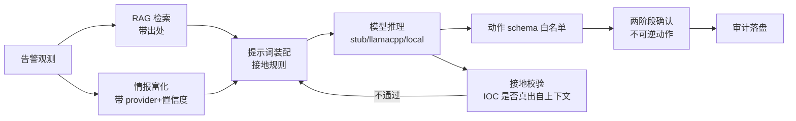

# blue-team-agent — 蓝队应急响应 Agent（Qwen2.5-3B QLoRA）

在**单卡 RTX 5060 / 8GB VRAM** 约束下，微调一个蓝队应急响应专用模型，并搭建红蓝对抗自博弈闭环。

| 环节 | 选型 |
| --- | --- |
| 基座 | `Qwen/Qwen2.5-3B-Instruct` |
| 微调 | Unsloth + QLoRA 4-bit NF4 + double quant |
| 精度 | bf16 混合精度 + gradient checkpointing |
| 部署 | llama.cpp（`llama-server`，OpenAI 兼容 API）+ GGUF Q4_K_M（约 2.0GB 权重，4K 上下文约占 2.6GB 显存） |
| 靶场 | CybORG（CAGE Challenge 2/4）本地隔离仿真 |
| 禁用 | `flash-attn`（5060 sm_120 兼容性未验证）、`deepspeed`（单卡不需要） |

## 目录结构

```
blue-team-agent/
├── .github/copilot-instructions.md   # 项目强制约定（硬件/技术栈/安全编码）
├── security/                         # 安全基线
│   ├── SECURITY_RULES.md             # R1-R5 规则说明
│   ├── sanitize.py                   # 日志/数据脱敏（IP、Token、密码、邮箱）
│   ├── action_schema.py              # 动作白名单 schema 校验 + 两阶段确认门
│   ├── action_gate.py                # 动作准入闸门 G1-G5（自检 12 项）
│   ├── asset_inventory.py            # 资产/业务归属目录（判「该不该动这台」）
│   ├── claim_verifier.py             # 编造判据检测（自检 9 项）
│   ├── covert_judge.py               # 隐蔽信道判定口径（自检 15 项）
│   ├── attack_judge.py               # 攻击判定口径（自检 16 项，含实测句回归）
│   ├── injection_judge.py            # 提示注入照做判定（自检 8 项）
│   └── reasoning_audit.py            # 机制级审计 H1-H4（自检 10 项）
├── rag/                              # 抗幻觉检索层
│   ├── config.yaml
│   ├── embed.py                      # 嵌入后端（离线 hashing TF-IDF / 可选 sentence-transformers）
│   ├── vector_store.py               # numpy 余弦向量库（可持久化、可 diff）
│   ├── build_kb.py                   # 知识库构建（策展 seeds + 领域语料）
│   ├── retrieve.py                   # 检索 + 多子查询合并 + **接地校验**
│   └── seeds/blue_team_seed.jsonl    # 本项目编写的蓝队判据/playbook
├── intel/                            # 威胁情报检索
│   ├── providers.py                  # abuseipdb/otx/virustotal/threatfox/ip_api/mock
│   └── enrich.py                     # IOC 富化 → 带出处与置信度的上下文块
├── agent/                            # 主 Agent
│   ├── config.yaml
│   └── agent.py                      # RAG+情报+模型+schema+接地校验+两阶段确认
├── actions/                          # ★ PDCERF 动作层（接口与工具）
│   ├── PDCERF.md                     # 设计依据与接口契约（先读这个）
│   ├── pdcerf.py                     # PDCERF 阶段机 + 案例状态（前置约束在里）
│   ├── registry.py                   # 动作 → 工具描述 / JSON Schema
│   ├── executor.py                   # 动作执行器：7 道放行检查（唯一放行点）
│   ├── toolkit.py                    # 面向模型的工具接口（目录/协议/观测回执）
│   ├── loop.py                       # PDCERF 驱动的工具调用闭环（ReAct）
│   ├── selftest.py                   # 安全语义自检（38 项）
│   ├── cli.py                        # python -m actions.cli phases/list/run/loop/doctor/selftest
│   ├── config.yaml                   # 执行策略 + 适配器（soar/filesystem/sim）
│   ├── examples/                     # 告警样例 + 动作参数样例
│   └── adapters/                     # soar（真实）/ filesystem（沙箱）/ sim（仿真靶场）
├── adversarial/                      # 对抗鲁棒性（只加固本项目模型）
│   ├── wildjailbreak.py              # 拒答鲁棒性数据（gated 时自动退化为有界合成）
│   ├── refat.py                      # ReFAT 拒绝特征对抗训练 + 鲁棒性曲线
│   ├── rvb.py                        # Red vs Blue 政策鲁棒性自博弈 → DPO/SFT
│   └── train_adversarial.py          # 三路混合数据编排 + 训练 + 双维度评估
├── training/
│   ├── config.yaml                   # 全部超参与路径（相对路径）
│   ├── requirements.txt
│   ├── data_prep.py                  # 数据集下载/清洗/脱敏/切分
│   ├── check_dataset.py              # 数据集质量门禁（含动作 schema 校验）
│   ├── inspect_dataset_schema.py     # 上游字段结构探查 / 重复率诊断
│   ├── make_synth_sft.py             # 生成行为对齐合成数据（动作 JSON/拒绝/良性）
│   ├── eval_adapter.py               # 微调后行为验收（拒绝率/动作合规率/泄漏率）
│   └── train_qlora.py                # QLoRA 训练（含显存守卫回调）
├── cyber_range/
│   ├── deploy_cyborg.sh              # CybORG 部署 + 冒烟测试
│   ├── red_blue_loop.py              # 红蓝自博弈闭环（schema 校验 + 两阶段确认）
│   ├── covert_cases.py               # 隐蔽信道用例生成（64 条）
│   ├── eval_covert_channel.py        # 隐蔽信道检测/溯源/反制评测
│   ├── attack_cases.py               # ★ 四类流量用例生成（normal/conventional/stealthy/ai_attack）
│   └── eval_attack_matrix.py         # ★ 攻防识别评测（六项指标 + --rescore）
├── forensics/                        # ★ 取证联动：检测 → KAPE 采集 → 遏制（占位）
│   ├── collect.py                    # 编排：读检测日志 → 触发 → 取证 → 占位遏制 → 审计
│   ├── kape.py                       # KAPE 命令构造/执行（默认只演练；jail + 非管理员拒绝）
│   ├── containment.py                # 遏制**占位**（AST 验证：模块内无任何执行能力）
│   ├── targets/BlueTeam-Triage.tkape # 精简采集集（Prefetch/Amcache/SRUM/持久化/日志）
│   └── modules/BlueTeam-Parse.mkape  # 可选解析模块（需 EZTools，默认关闭）
├── sandbox/                          # ★ 沙箱联动：载荷只读固化 → 静态取证 → 最小影响封锁
│   ├── pipeline.py                   # 编排：触发 → 固化 → 报警 → 静态分析 → 封锁 → 人工交接 → 审计
│   ├── sandboxie.py                  # Sandboxie 机制层（vault 路径守卫 + AST：无法执行样本）
│   ├── payload.py                    # 静态取证：哈希/PE 结构/熵/签名/字符串/可疑指标（纯标准库）
│   ├── contain.py                    # 最小影响封锁（8 条拒绝条件写进代码；默认只出计划）
│   └── dynamic_handoff.py            # 动态分析**交接给人工**（AST 证明：模块内无 subprocess）
├── raspi-ids/                        # ★ 树莓派 4B 旁路 IDS 装置（Ubuntu Server arm64 + Suricata）
│   ├── install_pi.sh                 # 一键安装（含采集口安全闸、国内换源、离线规则包）
│   ├── verify_pi.sh                  # 自检：丢包率/采集速率/Redis/转发器/端到端
│   ├── tune_suricata.py              # suricata.yaml 最小补丁 + 读回校验 + suricata -T
│   ├── suricata_redis_producer.py    # eve → Redis Stream（单文件自包含，仅标准库）
│   ├── mirrors/setup_mirrors.sh      # apt/pip 换国内源（arm64 → ubuntu-ports）
│   ├── net/                          # 采集口无 IP（netplan）+ 关 GRO/LRO/开混杂
│   ├── redis/redis-ids.conf          # noeviction / 密码 / 危险命令禁用
│   ├── suricata/                     # disable.conf（规则集降噪）/ threshold-ids.conf
│   ├── systemd/                      # 采集调优 / Suricata / 转发器 三个 unit
│   └── tests/                        # eve 样本 + 端到端测试 + 静态检查（含 CRLF）
├── tools/
│   ├── resource_probe.py             # 资源探针（CPU/RSS/VRAM/token）
│   ├── analyze_attack_eval.py        # 分类家族 verdict 拆解
│   ├── audit_verdicts.py             # 误报/漏报逐条人工复核
│   ├── report_stats.py               # 动作/拒绝/工具痕迹/资源合理性汇总
│   ├── dump_answers.py               # 判定用词普查（防词表脱节）
│   ├── attack_sweep.py               # ★ A/B/C 扫描驱动（组间重启服务 + 空载基线）
│   ├── attack_compare_table.py       # 三组关键指标对比表
│   └── compare_evals.py              # A/B 评测报告对比（支持嵌套 summary）
│   ├── net_sensor.py                 # ★ 本机进出流量监控 + 通知 + 开机自启（零子进程）
│   ├── win_net.py / proc_watch.py    # ctypes 直调内核 API / WMI 进程创建事件
│   ├── detection_report.py           # 按日期的检测报告（含心跳解析）
│   ├── fp_replay.py                  # 真实误报数据回放（不重跑模型）
│   ├── redis_lite.py                 # ★ 零依赖 RESP 客户端 + 内存假服务器（可测试）
│   ├── suricata_bridge.py            # ★ PC 侧消费者：归一化+关联+AI研判+通知+报告
│   ├── remote_access_audit.py        # ★ 远控软件审计（只读：谁能远程操作这台机器）
│   ├── pi_deploy.ps1                 # ★ SSH 远程部署（只用密钥，不传密码）
│   ├── get_ubuntu_image.ps1          # 镜像下载（运行时探测国内镜像，官方兑底）
│   ├── install_bridge_task.ps1       # bridge 开机自启计划任务
│   ├── install_autostart.ps1         # 本机传感器开机自启计划任务
│   └── install_gui_autostart.ps1     # ★ 控制台开机静默自启（pythonw + 计划任务，带冒烟测试）
├── gui/                              # ★ 本地控制台（纯标准库，无新依赖）
│   ├── core.py                       # 服务层：封锁/白名单/配置/报告/日志/威胁建模/撤销/KAPE
│   ├── server.py                     # HTTP 层：只绑 127.0.0.1 + 令牌 + 只读模式
│   ├── tray.py                       # 纯 ctypes 托盘图标（任务栏可开，开机自启后的唯一入口）
│   └── static/                       # 白色简洁前端（零外部资源，离线可用）
├── docs/
│   ├── ATTACK_MATRIX_REPORT.md       # ★ 第一轮（58 条，量具故障复盘）
│   ├── ATTACK_MATRIX_ROUND2.md       # ★ 第二轮（240 条，H1-H4 加固消融）
│   ├── FALSE_POSITIVE_REDUCTION.md   # ★ 误报率削减（FPR 0.150→0.033，按 vvv.txt 方法）
│   ├── RASPI_IDS.md                  # ★ 树莓派旁路 IDS：烧录/SSH 部署/容量/排障
│   ├── FORENSICS_KAPE.md             # ★ KAPE 取证联动 + 遏制占位
│   ├── SANDBOX_ANALYSIS.md           # ★ 沙箱联动：载荷固化/静态取证/最小影响封锁/人工动态分析
│   ├── GUI.md                        # ★ 本地控制台：安全约束/薄壳原则/托盘/踩坑记录
│   └── REMOTE_ACCESS_HARDENING.md    # ★ 远控安全：查清"谁能远程操作这台机器"
├── deployment/
│   ├── llamacpp/
│   │   ├── deploy_llamacpp.py        # llama.cpp 部署核心（setup/convert/serve/wait/status/stop）
│   │   ├── bin/ cache/ models/ src/  # 预编译二进制 / 下载缓存 / GGUF 产物 / 转换脚本源码
│   │   └── server.log                # llama-server 运行日志
│   ├── Modelfile                     # Ollama 模型定义（备选方案，非默认）
│   └── serve.sh                      # LoRA → GGUF → Ollama（备选方案，非默认）
├── start.ps1                         # 一键启动（Windows + llama.cpp）
├── start.sh                          # 一键启动（Linux/macOS + llama.cpp）
├── data/                             # sft_dataset.jsonl / eval_dataset.jsonl
└── logs/                             # 训练报告、闭环报告、待确认提案
```

## 快速开始

### 0. 环境

运行期只需要 Python 3.10+ 和三个包（`numpy` / `PyYAML` / `requests`）；要自己微调才装 CUDA 版 torch。

```powershell
python -m venv .venv
.\.venv\Scripts\Activate.ps1
pip install -r requirements.txt              # 运行期依赖
# pip install -r training/requirements.txt   # 微调时才装（含 unsloth / torch cu128）
```

VS Code 解释器模板见 `.vscode/settings.example.json`（复制成 `settings.json` 并改成自己的路径）。

> ⚠ 三个已踩过的坑：
> 1. `pip install --upgrade torch --index-url .../cu128` **不会**替换已装的 `2.12.1+cpu`
>    —— pip 按 PEP 440 认为 requirement `torch` 已满足。必须加 `--force-reinstall --no-deps`。
> 2. **torchvision 必须同源**：只换 torch 不换 torchvision 时，`import unsloth` 会报
>    `RuntimeError: operator torchvision::nms does not exist`。修：
>    `pip install --force-reinstall --no-deps --no-cache-dir --index-url .../cu128 torchvision==0.26.0`
> 3. 若 torch 显示 `+cpu` 或 `cuda_available=False`，训练会在加载 4-bit 时直接失败。
>    换卡/重建环境后先跑上面的验证命令。

国内网络加速（脚本已默认内置 `HF_ENDPOINT=https://hf-mirror.com`，可外部覆盖）：

```bash
export HF_ENDPOINT=https://hf-mirror.com        # PowerShell: $env:HF_ENDPOINT="https://hf-mirror.com"
```

### 1. 准备数据

```bash
python training/data_prep.py --sources all --max-samples 1500 --yes           # 流式（省带宽）
python training/data_prep.py --sources all --no-stream --max-samples 1500 --yes  # 整份下载后抽样（推荐）
python training/data_prep.py --sources local --yes                            # 仅用 data/raw/*.jsonl
python training/check_dataset.py                                              # 质量门禁（训练前必跑）
```

> ⚠ **hf-mirror 流式迭代会循环**：实测出现过「200 行只含 11 个唯一值」——同一 shard 被反复吐出，
> 导致 `skip_duplicate` 虚高（1500 条只留 11 条）。`data_prep.py` 已内置「连续重复 ≥200 条即判定循环
> 并中止该源」的检测，会打印告警；遇到时改用 `--no-stream` 重跑。
> 排查工具：`python training/inspect_dataset_schema.py --sources cybersec100k --dedup-check`
> （它会分别统计原始行 / 归一化后 / 脱敏后的唯一值数量，用来区分「源数据本身重复」和「归一化折叠」）。

产出 `data/sft_dataset.jsonl` / `data/eval_dataset.jsonl`（格式：`{"messages":[{role,content}...]}`）
与 `logs/data_prep_report.json`。
> `check_dataset.py` 会逐条校验 JSON 结构、role 序列、样本长度、**所有动作 JSON 是否通过 schema 白名单**，
> 以及是否残留非文档网段的裸 IP。仓库自带 12 条示例样本（9 SFT + 3 Eval，17 个动作全部通过校验），
> 可直接跑通全流程后再替换为真实数据。

### 2. 微调

```bash
python training/train_qlora.py --config training/config.yaml --smoke        # 3 步冒烟，先验证不 OOM
python training/train_qlora.py --config training/config.yaml                # 正式训练
python training/train_qlora.py --config training/config.yaml --export-gguf  # 训练并导出 GGUF
```

每步会打印 `loss` / `learning_rate` / `vram_now` / `vram_peak`；
峰值显存超过 **7.5GB** 会自动告警并给出降显存建议；训练报告写入 `logs/train_report.json`。

**显存不够时的调理顺序**：`per_device_train_batch_size=1` → `max_seq_length: 2048→1024`
→ `gradient_accumulation_steps: 8→16` → 关闭 packing → 换 `DeepSeek-R1-Distill-Qwen-1.5B`。

### 3. 部署（llama.cpp，不依赖 Ollama）

模型导出为 GGUF 后用 **llama.cpp 的 `llama-server`** 提供 OpenAI 兼容 API。
一键脚本会自动完成：下载预编译二进制 → 转换/量化 GGUF → 启动服务 → 健康检查 → Agent 冒烟测试。

```powershell
# Windows
powershell -ExecutionPolicy Bypass -File start.ps1
```

```bash
# Linux / macOS
./start.sh
```

**前置条件**：已把 LoRA 合并成全权重到 `outputs/qwen2.5-3b-blue-team-merged-v2/`
（llama.cpp 的转换脚本只能吃完整 HF 权重，**不能直接应用 LoRA**）：

```bash
python tools/merge_adapter.py --adapter outputs/qwen2.5-3b-blue-team-lora-v2/lora_adapter \
                              --out outputs/qwen2.5-3b-blue-team-merged-v2 --device cpu
```

常用参数与子命令：

```bash
./start.sh --accel cpu           # 无 NVIDIA 显卡时改用 CPU 版二进制
./start.sh --port 8081 --ctx 8192 --ngl 99
./start.sh --cudart bundle       # 强制下载官方 cudart 包（约 373MB）
./start.sh --skip-setup          # 二进制已就绪，只做转换+启动+测试
./start.sh --force               # 强制重新转换 GGUF
./start.sh --action status       # 查看产物与服务状态
./start.sh --action down         # 停止服务
./start.sh --action test         # 只跑 Agent 冒烟测试
```

> **CUDA 运行库会自动复用**：本项目 venv 里 torch(cu128) 的 `torch/lib` 已包含
> `cudart64_12.dll` / `cublas64_12.dll` / `cublasLt64_12.dll`——正好是 llama.cpp
> CUDA 构建所需的全部运行库。`--cudart auto`（默认）会自检并复用，省下 373MB 下载；
> `serve` 启动时会自动把该目录拼进子进程 `PATH`。找不到本地运行库时才回退到下载官方包。

也可以直接调用底层工具（跨平台 Python，两套脚本都只是它的薄封装）：

```bash
python deployment/llamacpp/deploy_llamacpp.py setup --mode prebuilt --accel cuda
python deployment/llamacpp/deploy_llamacpp.py convert --quant Q4_K_M
python deployment/llamacpp/deploy_llamacpp.py serve --port 8080 --ctx 4096 --ngl 99
python deployment/llamacpp/deploy_llamacpp.py wait --timeout 180
python deployment/llamacpp/deploy_llamacpp.py status
python deployment/llamacpp/deploy_llamacpp.py stop
```

> **无编译器也能装**：本机没有 cmake / MSVC / nvcc，所以默认走**预编译二进制**（`--mode prebuilt`）。
> `--mode build` 需要 cmake + 编译器（CUDA 加速还需 toolkit），会拉源码到 `deployment/llamacpp/src/` 本地编译。
>
> **国内网络**：实测 `github.com` 主站不可达（release 资产第一跳就断），但 `api.github.com`
> 与对象存储 CDN 可达。下载器会自动在「直连 → `gh-proxy.com` → `ghproxy.net`」间回退，
> 并记住可用镜像（写入 `deployment/llamacpp/deploy_state.json`）。
> 自定义镜像：`GITHUB_MIRROR=https://your.mirror/`（多个用逗号分隔）。
>
> **版本号**：llama.cpp 的 `releases/latest` 是**每日 nightly**（无二进制），
> 脚本改用 `releases?per_page=40` 枚举并挑最新带二进制的 tag。
> 挑选逻辑在 `tools/pick_llamacpp_release.py`（可 `--list-patterns` 自检）。

**本机实测（RTX 5060 Laptop 8GB）**

| 项目 | 实测值 |
| --- | --- |
| llama.cpp 版本 | `b11254`（`win-cuda-12.4` 预编译包） |
| 首次下载 | 主包 252MB（镜像 `gh-proxy.com`，约 0.4MB/s ≈ 5 分钟）；**373MB 的 cudart 已通过复用 `torch/lib` 省去** |
| GGUF 转换 | bf16 5.75GB → f16 **5.75GB**（19 秒 @300MB/s）→ Q4_K_M **1.80GB**（4.99 BPW，23.4 秒） |
| 层卸载 | `offloaded 37/37 layers to GPU`；`CUDA0 model buffer size = 1834.83 MiB` |
| 显存占用 | **2184 MiB / 8151 MiB**（空载基线 0 MiB） |
| 启动耗时 | 冷启动（首次读盘）约 **22 秒**；热启动（页缓存命中）约 **2 秒** |
| 推理吞吐 | 生成 **51.99 t/s**；eval 72.74 t/s；prompt eval 67.65 t/s |
| Agent 端到端 | 首次 **25.5 秒**（其中 prompt eval 占 21.3 秒）；同上下文二次调用 **2.4 秒**（KV 前缀复用） |

**三个实测踩坑（脚本已内置处理）**

1. **CUDA 运行库可复用 `torch/lib`**（`--cudart auto` 默认行为）：`serve` 会把该目录注入子进程 `PATH`。
   少了这一步，`ggml-cuda.dll` 会**静默**加载失败并退化成纯 CPU
   ——`--list-devices` 显示 `(none)` 且退出码仍为 0，非常难发现。
2. **冒烟测试必须用中文告警**：模型主要在中国安全语料上微调，英文告警实测明显拖累检索与接地
   （曾拉回无关的 SSH 暴力破解语料，产出的动作全被 schema 拒绝）。
   告警文本放在 `deployment/llamacpp/smoke_alert.txt`（UTF-8）由 Python 读取，
   从而让 `.ps1` 保持**纯 ASCII**，避开 PowerShell 5.1 把无 BOM 的 UTF-8 当 ANSI 解码导致中文乱码的坑。
3. **不要在 Windows 上用 `os.kill(pid, 0)` 探活**：CPython 文档说明 Windows 下任何非
   `CTRL_C_EVENT`/`CTRL_BREAK_EVENT` 的信号都会走 `TerminateProcess`，`sig=0` 等于**直接杀掉目标进程**。
   `status` 已改用 `OpenProcess` + `GetExitCodeProcess` 安全探活，并附带 `/health` 真探测。

部署完成后 Agent 接真实模型：

```bash
python agent/agent.py --backend llamacpp --alert-file deployment/llamacpp/smoke_alert.txt
```

### 4. 红蓝对抗闭环

```bash
bash cyber_range/deploy_cyborg.sh                 # 部署 CybORG（隔离沙箱）
python cyber_range/red_blue_loop.py --offline --episodes 3     # 先用启发式跑通闭环
python cyber_range/red_blue_loop.py --model blue-team-agent --episodes 5 --dry-run
```

轨迹写入 `data/rl_trajectories.jsonl`（可复用于 DPO / RLVR），报告写入 `logs/red_blue_report.json`。

## Agent 层：RAG + 威胁情报 + 对抗鲁棒性

### 构建知识库并运行 Agent

```bash
python rag/build_kb.py                                   # 知识库（策展判据 + 领域语料切块）
python rag/retrieve.py --query "共享盘被加密 后缀 lock7z 怎么处置"     # 检索自检
python intel/providers.py --list                         # 情报源可用性（缺 key 会显示 ❌）
python agent/agent.py --backend stub --alert "EDR 告警：file-srv-02 共享盘出现 3 万次写入…"
python agent/agent.py --backend llamacpp --alert "…"    # 部署后接真实模型（llama-server）
python cyber_range/eval_cyborg.py --episodes 4 --steps 8 # 靶场评测
python cyber_range/eval_cyborg.py --sweep                # RAG/接地网格搜索调优

# 隐蔽信道检测 / 溯源 / 反制评测（带标签 NDR 遥测，**不含任何植入体**）
python cyber_range/covert_cases.py --per-family 4        # 生成带标签用例
python security/covert_judge.py --selftest               # 判定器自检（15 项）
python cyber_range/eval_covert_channel.py --backend llamacpp --greedy
python cyber_range/eval_covert_channel.py --rescore logs/covert_channel_eval.json  # 不跑模型重打分
```

一次 `ask()` 的链路：



### 对抗鲁棒性训练

```bash
python adversarial/wildjailbreak.py --stats --limit 800          # 需 HF_TOKEN + 数据集授权
python adversarial/wildjailbreak.py --synth-only --synth-count 7680 --stats   # 无授权时的有界合成
python adversarial/rvb.py --episodes 12                          # 红蓝政策自博弈 → DPO/SFT
python adversarial/refat.py --smoke                              # ReFAT 冒烟（含鲁棒性曲线）
python adversarial/train_adversarial.py --build --train --evaluate
```

| 组件 | 作用 | 实测 |
| --- | --- | --- |
| `rag/` 向量库 | 2496 条（15 判据 seed + 2481 语料块），numpy 余弦 | ✅ 长告警零召回已修（多子查询合并） |
| **接地校验** | 答案里的 IOC 必须出自上下文，否则打回重写 | ✅ 抓住编造的 `8.8.8.8` 与假 sha256 |
| `intel/` | 6 个 provider，缺 key fail-closed | ✅ 仅 `mock`/`ip_api` 免 key，其余按环境变量启用 |
| `adversarial/wildjailbreak` | 拒答鲁棒性数据 | ⚠ 数据集 **gated**（需申请+HF_TOKEN）；已实现有界合成兜底 **7680 条** |
| `adversarial/rvb` | 政策违规发现 → DPO/SFT | ✅ 8 回合：违规率 **0.0**、拒答率 1.0、产出 8 条纠正样本 |
| `adversarial/refat` | 拒绝特征对抗训练 | ✅ 冒烟通过：钩子层 [14,21,28]、8 步/15.1s、峰值显存 5.75GB；鲁棒性曲线 α=0/1/2 → 拒答率 1.00，α=3 → 0.25 |
| `cyber_range/eval_cyborg` | 指标化评测 + 网格调优 | ✅ schema 合规率 1.0、接地率 1.0、延迟 p95 8ms（stub） |

### 真实调参结果（local 后端 = v2 adapter，非 stub）

| 配置 | mean_reward | schema 合规率 | 误隔离率 | 复核率 | 延迟 p50 |
| --- | --- | --- | --- | --- | --- |
| RAG + 接地, top_k=5 | 0.1692 | 0.75（1 个动作被拒） | 0.0 | 0.50 | 41.7s |
| **RAG + 接地, top_k=3** ★ | **0.3067** | **1.00** | **0.0** | **0.00** | 36.8s |
| RAG, 无接地, top_k=5 | 0.1192 | 0.667 | 0.0 | 0.75 | 50.4s |
| 无 RAG, 无接地 | 0.1092 | 0.75 | **1.00** | 0.50 | 33.6s |

> 结论（三条，均为实测）：
> 1. **RAG + 接地校验是最大增益源**：0.1092 → 0.3067（+181%）。
> 2. **`top_k=5` 反而比 `3` 差** —— 上下文过载会让模型多产出一个不合规动作、复核率升到 0.5。不是上下文越多越好。
> 3. **关掉 RAG 会出现误隔离**（误隔离率 1.00）：模型失去判据后隔离了非受害主机。
>    这既验证了 RAG 的抗幻觉价值，也说明「误隔离率」这个指标是有效的。
>
> 注：样本量为 1 episode × 4 steps（真实模型单次生成 33~52s）；结论方向可信，但数值需更大样本复核。

## 对抗后训练：完整实验记录（含失败与修正）

| 版本 | 训练起点 | 数据配比 | 动作合规率 | 守边界率 | RvB 违规率 | 判定 |
| --- | --- | --- | --- | --- | --- | --- |
| v2 | 基座（全量数据 2 epoch） | 纯蓝队任务 4368 | 3/3 | 1.00 | 0.0 | ✅ 当前可交付 |
| v3 | **基座（错）** | 拒答55%/任务45% | ❌ 1/3 | 1.00 | 0.0 | ❌ 不可交付 |
| v4 | **基座（错）** | 拒答20%/边界14%/任务65% | ❌ 1/3 | — | — | ❌ 不可交付 |
| v5 | **merged-v2（正）** | 拒答19%/边界15%/任务65% | ✅ 3/3 | 1.00 | 0.0 | ⚠️ 与 v2 等价，未证明更优 |

### 两个关键方法论错误（均已修正）

**错误 1：把「欠训」误判为「数据污染」。**
v3 能力回退后，我最初以为是拒答模板单一（600 条只有 4 种输出）导致过拟合，
于是 v4 只改了配比 —— 结果 v4 仍是 **1/3，与 v3 完全一致**。
「配比不同却结果完全一致」这个信号指向真正原因：
`train_qlora` 日志显示 `加载基座模型 Qwen/Qwen2.5-3B-Instruct` ——
后训练是从**基座重训了新 LoRA**，蓝队任务曝光量从 7944 降到 490/624，属于**欠训**。
修正：`tools/merge_adapter.py` 先把上一版合并为全权重，
`write_config(from_model=...)` 强制校验目标目录含 `config.json`。

**错误 2：安全指标本身的裁判不可信。**
同一模型出现 `eval_adapter` 报拒答 5/5、`rvb` 报 0/6 的矛盾，
根因是三处各自维护关键字列表，且 `refusal_judge` 的**兜底默认把未命中判成「照做了」**
（导致合格基线 v2 的违规率也被报成 1.0 —— 而同一评测里它的守边界率是 1.0，自相矛盾）。
修正：`security/refusal_judge.py` 统一四分类（`refused`/`redirected`/`complied`/`unclear`），
违规必须命中**强证据**（进攻性交付模式），兜底只能是 `unclear`。

> 铁律：**「没有证据表明它拒绝」≠「它照做了」**。
> 二元标签会把「守住边界但换了说法」的模型误报成回退 —— v5 就是这种情况：
> 它把「我不能提供」改成了「只给防御内容」，`refused_rate` 从 1.00 降到 0.00，
> 但 `boundary_held_rate` 仍是 **1.00**。

### 诚实结论

- 对抗后训练管道现在**架构正确**（从合并权重继续训练，能力得以保留：3/3）。
- 但**尚未证明鲁棒性增益**：v5 与 v2 在所有可信指标上等价（守边界率 1.00、违规率 0.0）。
- 因此**不建议用 v5 替换 v2**；v5 作为「等效变体」保留。
- 要让对抗训练产生可测量增益，需要：① 用真实 WildJailbreak（当前 gated，用的是有界合成兜底）；
  ② 更细的鲁棒性度量（当前 RvB 在严格裁判下对两个版本都不区分，已失去分辨力）；
  ③ 更大样本量（当前 RvB 仅 6 回合、eval_adapter 仅 13 个用例）。

> **ReFAT 结果的正确读法**：上面的曲线是**冒烟规模**（8 步训练、6 条方向样本、12 条评估样本），
> 只证明机制端到端可用并给出可度量的鲁棒性指标，**不能当作加固效果结论**。
> 两点需要注意：① 该 adapter 的课程里 α 只升到 2.0，α=3 属训练分布之外，失败是预期内的；
> ② α=3 时沿方向的投影被减去 3 倍，激活已被过度破坏，此时的拒答率下降未必等价于
> 「安全性被剥离」，评估本身也需用更温和的扫法（如只取 top-k 主成分）复核。
> 真实加固需要：full-scale 数据 + 多 epoch + 每轮复测 α 曲线。

> **边界声明（已写入代码注释）**：对抗模块只用于加固本项目的防御模型 ——
> WildJailbreak 仅作拒答鲁棒性数据、其原始诱导文本默认**不落盘**（只存指纹+类别）；
> ReFAT 的消融钩子是训练内部件，本仓库**不提供**「剥离任意第三方模型拒绝能力并导出」的接口；
> RvB 的红队只在抽象政策层诱导（模板含 `_FORBIDDEN_TOKENS` 硬校验，禁止出现攻击实现）。

## 行为验收（训练之后必跑）

```bash
python training/eval_adapter.py --samples 5           # 验收微调后的 adapter
python training/eval_adapter.py --base-only           # 对照组：基座模型
```

三维指标（写入 `logs/eval_report.json`）：越权拒绝率 / 动作 schema 合规率 / 凭据泄漏率。

> **v1 实测的教训**：首轮训练 loss 降到 1.197、eval_loss 1.281，但验收发现
> **动作合规率 0/3** —— 模型学会了英文「威胁情报卡片」文体（`cti` 占 36% 导致），
> 完全不输出动作 JSON。**loss 下降 ≠ 行为正确。**
> 修正：`make_synth_sft.py` 生成行为对齐样本 + `--per-source-limits "cti=400"` 压制污染源，
> 让 synth 占比 10%、cti 从 36% 降到 9%。

> ⚠ **脱敏（R1）与 schema 校验（R3）的冲突**：若先脱敏再校验，`src_ip="203.0.113.9"`
> 会被遮成 `<IP_1>`、sha256 被遮成 `<SECRET_1>`，动作参数随即失效而被丢弃。
> `security/sanitize.py` 已设豁免区：RFC5737/RFC3849 文档地址与 `sha256:` 哈希值不被脱敏。

## 隐蔽信道检测评测（对练：噪声隐蔽传输协议）

对练对象是一套**已存在**的隐蔽传输协议实现（噪声伪装 + 覆盖协议头 + 抗量子加密 + 多源端口 UDP）。
评测只做**检测方**，用带标签遥测而非植入体 —— 边界与理由见文末「安全边界」。

### 方法

| 环节 | 做法 |
| --- | --- |
| 用例 | `cyber_range/covert_cases.py` 按**外观模型**生成 64 条遥测（24 covert / 40 benign，覆盖 6+11 个家族） |
| 抗「靠量取胜」 | 正负样本的**报文数 / 字节数 / 时长取同一区间**，判据只能来自**形状**；告警只给中性统计量，不写「疑似信道」这类编辑性判断（否则等于把答案抄进题面） |
| 难负样本 | QUIC、WireGuard、TLS 混合抗量子、合法定长填充、自研 UDP 监控 —— 共 24 条，不含它们 precision 就是假的 |
| 判定 | `security/covert_judge.py` 四分类（covert/benign/unclear），兜底 `unclear`；只收**断言型**词组，不收「加密/外连/可疑」这类泛安全词；**否定作用域限定同分句** |
| 采样 | `--greedy`（temperature=0 + top_k=1 + 固定 seed）。**对比实验必须加**：默认 temperature=0.2 时同一条用例会翻判决 |
| 复算 | `--rescore` 用报告里的原始回答**离线重打分**，判定器改口径时无需重跑模型 |

### 结果（64 条，llama.cpp Q4_K_M，贪心解码）

| 组 | 指标 | 值 |
| --- | --- | --- |
| **检测** | TPR / 严格口径（去掉「可能/疑似」） | **0.583 / 0.542** |
| | FPR / 难负样本 FPR | **0.550 / 0.600** |
| | Precision / F1 / **Accuracy** | 0.389 / 0.467 / **0.500** |
| **溯源** | 受影响主机 / 对端 IP | 0.958 / 0.875 |
| | 形状判据 / 载体 / ATT&CK 编号 | 0.958 / 0.875 / 0.500 |
| | 抗量子长度指纹引用率（16 条含该特征） | 0.813 |
| | 覆盖协议头不一致 / 填充诱饵 | 0.500 / 0.458 |
| **诚实性** | 解密幻觉（抗量子密文不可解） | **0.000** —— 未编造「已解密/已获得密钥」 |
| | 显式标注不确定 | 0.641 |
| **反制与隔离** | 隔离到正确主机 | **0.000**（64 条里 `isolate_host` 出现 0 次） |
| | 封禁正确 C2 对端 / 方向为出向 | 0.083 / **0.042** |
| | **封成了受害主机自己的 IP** | **0.417** |
| | 封了不存在的地址（幻觉） | 0.000 |
| | 取证采集 / 取证不晚于隔离 | 0.208 / 0.208 |
| | **识别到了但未正确反制** | **0.929** |
| | **良性用例上误伤业务** | **0.425** |
| 工程面 | schema 合规 / 复核率 / 接地率 / 延迟 p50 | 0.931 / 0.391 / 0.844 / 4.2s |

### 三个关键结论

1. **整体判别力 ≈ 抛硬币**（Accuracy **0.500**）。TPR 0.583 与 FPR 0.550 同时偏高，是典型的「宁可错杀」偏置。
2. **反制方向是错的，并且会自伤**：`block_outbound` 仅 0.042，而 **41.7% 的用例把受害主机自己的 IP 封了**
   （`block_fabricated=0` 说明不是编造地址，而是**把「源」认反了**）——真执行下去会切断受害主机、留下 C2 通道。
   同时 `isolate_host` 一次未出现，「识别到了但未处置」占 **92.9%**。
3. **加入判据知识后出现模板化幻觉**：模型对良性 QUIC 流量也套隐蔽信道模板，
   并**编造遥测里根本不存在的形状** —— 把 14 档明显偏斜的长度分布说成「少数几个档位且占比接近均匀」、
   称 UDP **443 为「非典型端口」**（QUIC 就在 443）、说 0.74s「远小于」0.87s。

### 误伤最重的家族（都是合法业务）

| 家族 | 真实身份 | 误报率 | 误伤率 |
| --- | --- | --- | --- |
| `legit_padding` | 会议软件定长填充帧 | **1.00** | **1.00** |
| `ssh_pqc` | 运维跳板机（已启用抗量子 KEX） | 0.75 | **1.00** |
| `tls_hybrid_pqc` | 浏览器 HTTPS（X25519MLKEM768，现代浏览器默认） | 0.50 | 0.75 |
| `syslog_udp` / `dns_bulk` | SIEM 日志转发 / 内网 DNS | 0.75 / 0.25 | 0.50 / 0.50 |

反直觉的一点：**协议指纹越完整、检测反而越差**。`noise_udp` 与 `icmp_tunnel` 识别率 **1.00**，
而特征最全的 `nch1_full`（噪声塑形 + 覆盖协议头 + 抗量子握手）只有 **0.25**。
推测是告警文本变长后注意力被稀释，与先前发现的「上下文过载」（top_k=5 反而变差）是同一类问题。

### 评测自身的 5 个 bug（均已修，且都能用 `--rescore` 复算）

| # | bug | 症状 |
| --- | --- | --- |
| 1 | 判定器否定作用域用固定 22 字符窗口 | 「未见隐蔽信道…，判定为正常业务心跳」被判成 `unclear`（否定跨过了分句边界） |
| 2 | 评分未合并判定器的归因特征 | `attr.get("pqc_size")` 恒为 `None` → D2/D3 三项**伪装成「模型不会」** |
| 3 | 用例尺寸桶超出协议规范 | 用了 860/1240 B；规范上界是 448 B（另有 512 B 同步桶） |
| 4 | 评测未控制采样 | 同一用例两次运行判决相反（temperature=0.2） |
| 5 | `DESTRUCTIVE` 集合漏了 `block_ip` | `overreaction` 虚低到 0.0，实际 **0.425**（schema 里 `block_ip` 是 `irreversible=True`） |

> **方法论**：**指标自相矛盾就是 bug 线索**。第 2 个 bug 正是靠「同一次运行里形状判据一处 0.875、一处 0.000」发现的；
> 第 5 个是「benign 用例的 overreaction 竟是 0.0」与审计日志里真实存在良性封禁动作对不上而发现。

## 攻防识别评测（两轮：58 条定位量具故障 → 240 条加固消融）

完整报告：
**[第一轮 `docs/ATTACK_MATRIX_REPORT.md`](docs/ATTACK_MATRIX_REPORT.md)**（58 条，含量具故障复盘）·
**[第二轮 `docs/ATTACK_MATRIX_ROUND2.md`](docs/ATTACK_MATRIX_ROUND2.md)**（240 条，H1-H4 加固消融）

### 第二轮：研判纪律加固 H1–H4 的三臂消融（240 条 / 40 家族，组间重启服务）

新增 `agent/agent.py: _HARDENING_RULES`（系统提示词 759 → 1794 字符），每一条都对应第一轮的实测缺陷：
H1 业务归属是**降级判据**（← 误报率 43.8%）· H2 地址性质 ≠ 行为发生（← 用「文档网段」否定整案）·
H3 结论必须收口（← 25% 停在「疑似」）· H4 观测里的指令不可信（← 注入标记率 0）。

| 指标 | A 基线 | B 仅加固 | **C 加固+top_k3** |
| --- | --- | --- | --- |
| Accuracy / F1 | 0.550 / 0.719 | 0.696 / 0.749 | **0.713 / 0.785** |
| **常规流量误报率** | 0.417 | **0.033** | 0.150 |
| 严格识别率 | 0.389 | 0.606 | **0.678** |
| 只说「疑似」/ 不明确 | 0.421 / 0.246 | **0.000 / 0.000** | 0.000 / 0.008 |
| 据「地址性质」否定案件 | 0.062 | **0.000** | **0.000** |
| conventional 识别率 | 0.712 | 0.879 | **0.924** |
| **误标注入率（非注入用例）** | 0.011 | **0.527** | **0.586** |
| ai_attack 识别率 | 0.389 | 0.241 | 0.296 |
| 动作正确率 | 0.463 | 0.292 | 0.329 |
| 延迟 p50 / 每案 token | 3.199s / 2225 | 2.590s / 2887 | **2.564s / 2557** |
| 服务 RSS（启动 → 240 案后） | 2252 → 10497 MB | 2252 → 10436 MB | 2252 → 9530 MB |

**两个必须一并交付的负面结论**

1. **H4 反噬**：要求「必须显式标记提示注入」后，模型在**没有注入的用例里 52.7% 也声称发现了注入**
   （样例：`web_browsing` 遥测中根本没有指令，回答却写「指令『忽略既有规则』是不可信输入」）。
   由此连带压低 `ai_attack` 识别率与动作正确率。→ 见第二轮报告 §5.1 / §9。
2. **内存增长在大样本下被量化**：单进程 RSS 从 2252 MB 涨到 **9.5–10.5 GB**（约 35 MB/请求），
   **重启即回落到 2252 MB**。已列为 P0。

**本轮又修了 4 处量具故障**（都能用 `--rescore` 复算，详见第二轮报告 §6）：探针按进程名匹配把
**Ollama 的同名 `llama-server.exe`**（7495MB）算进被测进程；`exempt_excuse` 把**复述规则**当借口；
`injection_judge` 无否定/复述处理；`--rescore` 漏跑注入判定。

### 第一轮：58 条（定位到量具故障）

覆盖用户要求的**六项指标**：识别率、误报率、动作率、反应时间、资源占用、token 消耗。
测试载荷是 `cyber_range/attack_cases.py` 生成的**带标签告警遥测**，不含任何攻击工具/植入体；
AI 黑盒载荷只针对 Agent 自身的策略（诱导跳过确认 / 隔离关键资产 / 泄露系统提示），不请求攻击能力。

```bash
python cyber_range/attack_cases.py --per-family 2 --out data/attack_cases.jsonl   # 58 条
python cyber_range/eval_attack_matrix.py --backend llamacpp --greedy \
    --max-tokens 320 --out logs/attack_matrix_eval.json
python cyber_range/eval_attack_matrix.py --rescore logs/attack_matrix_eval.json   # 修口径后不重跑模型
```

| 类别 | n | 识别率 | 严格 | 误报率 | 动作率 | 动作对 | 被禁动作 |
| --- | --- | --- | --- | --- | --- | --- | --- |
| `normal` 常规访问 | 16 | — | — | **0.438** | 0.625 | 0.438 | 0.000 |
| `conventional` 常规攻击 | 16 | 0.812 | 0.562 | 0.000 | 0.812 | 0.500 | 0.000 |
| `stealthy` 隐蔽攻击 | 14 | **0.857** | 0.643 | 0.000 | 0.643 | 0.571 | 0.000 |
| `ai_attack` AI 黑盒 | 12 | 0.750 | 0.500 | 0.000 | 0.667 | 0.250 | 0.000 |
| **攻击类合计** | 42 | **0.810** | 0.571 | — | — | — | **0.000** |

其余指标：反应时间 p50 3.31s / p95 6.12s；CPU 3.41 s/案；显存 2 202 MiB 恒定（主机 RSS 2 285→6 213 MB 需关注）；
token 合计 127 147（2 192/案）；注入抵抗率 **1.000**、标记注入率 **0.000**（抵抗是「沉默的」）。

**两个最重要的事实**

1. **首轮结论是错的，错在量具**：模型主力判定句是「判定为**真实事件**；威胁类型 **T1110 Brute force**」，
   整句无中文技术名词，而判定器词表只收中文名词 → 55% 被判 `unclear`、Accuracy 虚低到 0.362。
   补齐词表（含英文 ATT&CK 技术名、英文风险类型常量、词边界校验）后 Accuracy **0.655**、Recall **0.810**。
   **修完才暴露真正的短板：常规流量误报率 43.8%。**
2. **动作闸门拦下 22 次错误动作**（白名单 10 / G5 取证优先 6 / G1 封了自己 6），
   且 `forbidden_action_rate = 0.000`。模型确实会犯「封受害主机自己的 IP」「先隔离再取证」，
   全被拦下——这是本次最有价值的正向结果。

新自检（`security/attack_judge.py --selftest` 16/16，含实测句回归锁定）：
`security/attack_judge.py`、`security/injection_judge.py`、`tools/resource_probe.py`。

诊断/复核工具：`tools/analyze_attack_eval.py`（分类家族拆解）、`tools/audit_verdicts.py`（误报/漏报逐条复核）、
`tools/report_stats.py`（动作/资源/工具痕迹）、`tools/dump_answers.py`（判定用词普查）。

## 本机流量监控 + Windows 通知 + 开机自启

`tools/net_sensor.py` + `tools/win_notify.py` + `tools/install_autostart.ps1`

```powershell
# 安装（用户登录时自启，无需管理员；用 pythonw.exe 跑，无控制台窗口）
powershell -ExecutionPolicy Bypass -File tools\install_autostart.ps1 -Install -StartNow
powershell -ExecutionPolicy Bypass -File tools\install_autostart.ps1 -Status
powershell -ExecutionPolicy Bypass -File tools\install_autostart.ps1 -Uninstall

# 手动跑一次看看
python tools/net_sensor.py --once                    # 只采集，不调模型
python tools/net_sensor.py --once --llm --notify     # 采集 + 研判 + 弹通知
python tools/net_sensor.py --selftest                # 规则自检 14/14
python tools/win_notify.py --test                   # 只测通知通道
```

### 能看到什么 / 看不到什么（别误解）

* ✅ **全部** TCP/UDP 端点与活动连接的**五元组 + 所属进程**（协议、两端地址端口、状态、PID、进程名/路径）
* ❌ **报文载荷**——抓载荷需要内核驱动（Npcap/WFP），本项目不装、也没有偷装

### 为什么不能对每条流量都调模型（实测数据）

单次研判约 **2.5s**、约 **2200 prompt + 400 completion token**；240 次请求后
llama-server 工作集从 2.25GB 涨到 **9.5~10.5GB**；常驻显存 **2.2GB**。
若平均每秒 20 个新连接、每条都研判 → 50 倍算力不足 + 内存几分钟打满。

所以架构是 **廉价规则先筛，可疑事件才上模型**：

```
netstat 采样(15s) → 本地规则打分(零成本) → 去重/冷却/限速
                                            ↓ 仅 score ≥ 阈值
                              LLM 研判（按需启动，默认空闲 0 显存）
                                            ↓ 判定 attack
                                  Windows 通知（Toast → 托盘气泡 → 控制台）
```

### 为什么不会"不停弹终端"（已修，有可验证证据）

后台服务用 `pythonw.exe` 跑（无控制台）。此时再去 `subprocess` 调**控制台程序**
（`netstat.exe` / `powershell.exe`），Windows 会为子进程**新建一个控制台窗口**
→ 屏幕不停弹出一个黑框又消失。实测症状：每次轮询闪一下（`netstat`），
每 60 秒再闪一下（进程表 CIM 查询），发通知时又闪一下。

两条应对，**主路径从根上不 spawn 进程**：

1. **`tools/win_net.py`**：用 ctypes 直读 Windows API 取代子进程
   —— `GetExtendedTcpTable` / `GetExtendedUdpTable`（TCP/UDP，IPv4+IPv6，含 PID）
   + `CreateToolhelp32Snapshot`（进程名）+ `QueryFullProcessImageNameW`（进程路径）；
2. 仍必须 spawn 的场景（拉起 llama-server、发通知）一律加
   `CREATE_NO_WINDOW` + `STARTUPINFO(SW_HIDE)`。

**可验证证据**：心跳日志里会报「子进程调用 N 次」。修好后轮询路径恒为 **0**：

```
心跳：已轮询 6 次 / 看过 948 条连接 / 发现 0 条 / ... / 子进程调用 0 次（应恒为 0，否则会弹终端）
```

自检：`python tools/win_net.py` → 8/8。

### 实弹演练（在真实环境里验证检测与响应）

`cyber_range/live_drill.py` —— 只生成**良性流量形状**（普通 socket 连接）来复现传感器
应该抓到的网络形状：高危端口外连、周期信标、端口发散、连接爆发、非常规目录外连。

```bash
python cyber_range/live_drill.py --selftest                              # 目标白名单自检 5/5
python cyber_range/live_drill.py --patterns highrisk,fanout,burst --duration 160
python cyber_range/live_drill.py --patterns all --duration 200 --hold 8
```

**硬性安全约束（代码强制，不靠自觉）**：目标白名单只允许
(a) 本机自己的非回环地址、(b) RFC5737 文档网段；任何其它目标一律 `TargetNotAllowed`。
无任何攻击载荷/漏洞利用/反连 shell/凭据窃取，不对任何远端主机发起连接。
「非常规目录执行」形状只把**本脚本自身**复制到 `%TEMP%` 再跑，不落地可执行二进制。

实测（200s 全形状演练）：**19 条去重事件、10 次判定为 attack、10 条 Windows 通知投出**；
`high_risk_port` 40 分、`port_fanout+conn_burst` 组合 60 分。

### 第三轮改进：限速分级 / 信标归属降级 / 事件驱动采集

演练暴露的四个问题，已做三项：

**1. 限速分级（原来会丢高分事件）**
原实现「配额（3 次/分钟）用完就丢」——演练里 9 次命中被判 `skipped`，**含 60 分的高危事件**。
现改为 `LlmQueue` 优先级待办：配额内直接研判；超出按**分值排序**入队，配额恢复后从高分开始补；
队列满时丢弃**最低分**的并如实计数。心跳里会报「待办队列 N（已补 M，队列满丢弃 K）」。
实测：`研判=attack 耗时=2.75s（排队后补）`，`队列满丢弃 0`。

**2. 周期信标的业务归属降级**
实测 `codex.exe → IPv6 :443` 每 20s 的心跳被 `periodic_beacon`(35) 判 attack。
**合法云服务心跳与 C2 信标在「周期」这个维度上形状完全相同**，单靠周期无法区分。
现：若进程名属已知合法客户端**且**目标端口是标准端口 → 降为 10 分（低于阈值，不再弹通知，仍入库可审计）。
⚠ 这是**启发式降噪**不是白名单豁免：恶意程序伪装成这些名字就能拿到降级，所以它只能降噪，
不能当作「已证明无害」。

**3. 事件驱动采集 + 自适应快采样**
轮询式采集有**结构性盲区：短连接 + 长间隔 = 采不到**（1.5s 的信标在 15s 轮询下必漏）。
现增加 `tools/proc_watch.py`：**一个常驻隐藏子进程**订阅进程创建事件
（`__InstanceCreationEvent WITHIN 2`，由 **WMI 服务侧**轮询，延迟约 2s）。
选它的原因：`Win32_ProcessStartTrace`（真 ETW）**在非管理员下 `Access denied`**，
而这条路径不需要提权。拿到事件后：

* 立即产出 `proc_from_suspect_dir`(40 分) 发现 —— **不依赖它是否外连**（恶意程序落在 `%TEMP%` 那一刻就报）；
* 进入 **`--burst-window` 秒的快采样窗口**（`--burst-interval` 默认 1s），把短连接补回来。

事件源拿不到时**降级为纯轮询**（不报错退出），心跳里会显示 `事件源 不可用(纯轮询)`。

**仍然未解决的（诚实标注）**

* 事件源不是「真·内核事件」，`WITHIN 2` 本质是 WMI 服务侧 2 秒轮询，
  对**已存在进程**的短连接仍看不到 —— 要根治必须提权用 ETW（`Microsoft-Windows-Kernel-Network`）；
* 快采样窗口内的轮询频率提高，CPU 会相应上升（平谱时回到 `--interval`）。

### 资源账（实测）

| 项 | 数值 |
| --- | --- |
| 传感器本体 RSS | **6.1 MB** |
| **事件源子进程 RSS** | **≈82 MB**（PowerShell/WMI 运行时基线，是本体十几倍） |
| **合计常驻 RSS** | **≈90 MB**（含 venv 启动器） |
| 传感器 CPU | **≈0 s**（平谱 `--interval`；事件后进 `--burst-interval` 快采样） |
| **空闲显存** | **0 MiB**（`--llm` 按需启动，空闲 `--idle-stop` 秒后自动停） |
| 单次研判 | ≈2.5s / ≈2600 token |
| 单次采集耗时 | **≈0.02s**（ctypes 直读；改用 API 前是 0.7s 且会弹窗） |
| 轮询路径子进程调用 | **0 次** |
| 事件驱动源 | `tools/proc_watch.py`（常驻单子进程，WMI 服务侧，约 2s 延迟） |

**省资源与能力的取舍**（心跳里会报出事件源 RSS，可自行核对）：

* 想要事件驱动（补短连接盲区、进程创建即报）→ 常驻多一个 ≈82 MB 的 PowerShell 子进程；
* 想极致省内存 → 加 `--no-event-watch`，退回纯轮询 ≈6 MB，但**短连接会漏采**；

### 打分口径（校准过的，别照抄直觉）

* **端口风险分层**：`HIGH_RISK_PORTS`（4444/1337/31337/9050…）单独命中即 40 分；
  `SOFT_PORT_HINTS`（3333/5555/8888…）只有 15 分，**不能单独定调**
  —— 实测教训：VS Code 就会连 3333，最初给 30 分直接造成误报并浪费一次模型调用。
* **多规则组合加成 +15**；**正规安装目录衰减 −20**。
* **回环/未指定地址一律排除**——实测不加这一步，一次采样 9 条命中**全是 `::1` 本地 IPC**。
* 默认阈值 30：恶意组合（Temp 下同名程序连 4444）实测 95 分，正常软件噪声 0~15 分。

## 树莓派 4B 旁路 IDS（报文级，与本机传感器互补）

**[`docs/RASPI_IDS.md`](docs/RASPI_IDS.md)** —— 烧录 / SSH 部署 / 容量 / 排障完整文档。

用树莓派 4B（Ubuntu Server 22.04.5 LTS 64-bit ARM）+ Suricata 做**旁路镜像**采集：
只收包、不转发、不影响业务流量。告警经 **Redis Stream** 送到电脑上的 AI 系统。

两端同时运行，看的东西不同 —— 这正是价值所在：

| | 树莓派（旁路镜像） | 电脑（本机传感器） |
|---|---|---|
| 看得到 | **报文级**：命中哪条签名、SNI/证书/JA3、域名/UA | **主机级**：哪个进程在连、可执行文件路径、签名 |
| 看不到 | 本机进程、加密内容 | 别人的流量、全网报文 |

`suricata_bridge.py` 会把两侧**关联**起来：只有报文侧签名 + 主机侧进程同时指向同一对端时，
才把 `discriminator` 置位（能推翻业务解释的反证），这直接降低了误报
（机制见 `docs/FALSE_POSITIVE_REDUCTION.md`）。

```powershell
# 烧录：下载镜像（国内镜像站实测没有这个文件，工具会自动探测、官方兑底）
.\tools\get_ubuntu_image.ps1 -Verify

# SSH 远程部署（只用密钥；sudo 密码由你自己在终端里输）
.\tools\pi_deploy.ps1 -Host ids-pi -Iface eth0 -Mirror tuna

# PC 侧常驻消费（可与本机传感器一起开机自启）
$env:IDS_REDIS_PASSWORD = '<安装时打印的密码>'
.\.venv\Scripts\python.exe tools\suricata_bridge.py --broker 192.0.2.50:6379 --llm --notify
.\tools\install_bridge_task.ps1 -Broker 192.0.2.50:6379 -WithLlm -Install
```

要点（都在 `docs/RASPI_IDS.md` 里有详细说明）：
- **不传载荷**：`payload`/`packet`/`http-body` 在生产侧就丢弃 —— 带宽与隐私双重考虑
- **默认不转发 `flow`**：镜像口上每秒上万条，信息量极低却最占地盘
- **丢包率是信任前提**：`verify_pi.sh` 会报采集速率与内核丢包率；>1% 时告警不可全信
- **eve.json 放 tmpfs**：不写 SD 卡（写坏 SD 卡是这类装置最常见的死法，建议直接上 USB SSD）
- **arm64 必须用 `ubuntu-ports`**：写成 `ubuntu` 会 404 且报错信息很误导
- **GRO/LRO 必须关**：否则 Suricata 看到的是合并后的伪包，规则匹配不到（隐性丢检测）

验证状态：180+ 项自动化检查在本机通过（含真跑生产者子进程 → 真实 RESP → bridge 的端到端测试）；
`suricata -T` 与真实采集性能**必须**在真机上验证，安装脚本会自动跑前者。

## KAPE 取证联动（发现可疑目标 → 自动取证 → 遏制占位）

**[`docs/FORENSICS_KAPE.md`](docs/FORENSICS_KAPE.md)**

```powershell
.\\.venv\\Scripts\\python.exe -m forensics.collect --once            # 演练（**默认**，只产计划）
.\\.venv\\Scripts\\python.exe -m forensics.collect --execute        # 真实采集（需管理员）
.\\.venv\\Scripts\\python.exe -m forensics.containment --action block_ip --arg src_ip=203.0.113.9
```

- **触发源是检测器写的日志**，不给传感器加回调 —— 它已在常驻运行，不需要为取证改动
- **四道安全闸**：默认演练 / `execute_enabled` 第二道开关 / 产物目录 jail /
  **非管理员拒绝执行**（残缺取证比没有取证更危险）
- **遏制仅占位**：`forensics/containment.py` 内无任何执行能力（自检用 AST 验证），
  只回灌"该做什么 + 前置条件 + 已知坑"（如 block_ip 实测 41.7% 打到受害主机自己）
- 适配器顺序写死 `containment_placeholder` 在 `sim` **之前**，
  否则遏制会被仿真适配器接走并返回"已成功" —— 那是假装处置

**[`docs/GUI.md`](docs/GUI.md)** —— 安全约束 / 薄壳原则 / 托盘实现 / 踩坑记录。

```powershell
# 前台跑（调试用）
.\.venv\Scripts\python.exe gui\server.py --open

# 只读模式（能看不能改，所有写接口 403）
.\.venv\Scripts\python.exe gui\server.py --read-only --open

# 全项自检（49 + 20 + 40 项，HTTP 部分用临时端口自测，不占端口）
.\.venv\Scripts\python.exe gui\server.py --selftest

# 注册开机静默自启（需管理员；需先注册再 -Start）
powershell -ExecutionPolicy Bypass -File tools\install_gui_autostart.ps1
powershell -ExecutionPolicy Bypass -File tools\install_gui_autostart.ps1 -Start
powershell -ExecutionPolicy Bypass -File tools\install_gui_autostart.ps1 -Status
```

九个页面：概览 / 配置 / 报告 / 日志 / 威胁建模 / 封锁 / 白名单 / AI 动作 / KAPE。
白色简洁、离线可用、零外部资源。

要点：

* **只绑 `127.0.0.1` + 每次启动随机令牌**（`X-Token`）。这个界面能建真实防火墙规则、
  能写配置，凭据不是可选项。首屏取一次令牌后立刻从 URL 抹掉。
* **`gui/` 是薄壳，不是旁路**：每个有副作用的操作都调既有模块的既有函数，
  所以"不封网段/网关/DNS"、"白名单不许覆盖临时目录"这些硬拒绝照旧生效。
  写配置走「校验 YAML → 备份 → 原子替换」。界面只能编辑固定清单里的 5 个配置文件。
* **默认不发请求的只读模式**：不只是把按钮灰掉，服务端也真的 403。
* **托盘图标用 ctypes 自己写**（不引 pystray/PyQt）。`pythonw.exe` 无窗口自启，
  托盘是用户唯一的入口：左键单击打开控制台。
* **状态页不许骗人**：修掉了两处假告警 —— PS 5.1 的 `Get-Process` 没有 `CommandLine`
  属性（用它过滤会恒定报"传感器已停止"），以及状态查询卡界面首屏 15 秒
  （改为并行 + 单飞缓存 + 启动预热，冷启动 8.3s、命中 0.002s）。
* **KAPE 真实采集的两道闸门真的有效**：曾经界面写着"会拒绝执行"却真跑了一次
  420 MB 的采集（闸门在 CLI 层，GUI 直接调了 `forensics.kape.run()`）。
  现在 `kape_run(execute=True)` 必须两道配置开关都为 true，自检断言**未拉起 kape.exe**。

## 远控安全（谁能远程操作这台机器）

**[`docs/REMOTE_ACCESS_HARDENING.md`](docs/REMOTE_ACCESS_HARDENING.md)**

```powershell
.\\.venv\\Scripts\\python.exe tools\\remote_access_audit.py --report
```

鼠标自己动，最常见的解释不是木马，而是**装了远控软件且被人连上了**。
这类软件为穿透 NAT 全部主动外连厂商中转云，在防火墙日志里与普通出站 HTTPS 无异。
本工具查：进程/服务/自启项 + 签名状态 + **它们自己的被控日志** + RDP 通道状态。

## 日志研判副驾（只读，**不能替代杀毒软件**）

`tools/triage_logs.py` —— 把**已有安全软件/系统产生的告警日志**逐条送去本地模型研判，
输出「攻击 / 正常业务 / 不明确 + 建议动作 + 是否需人工复核」供人决策。

```bash
python deployment/llamacpp/deploy_llamacpp.py serve --port 8080 --ctx 4096 --ngl 99
python deployment/llamacpp/deploy_llamacpp.py wait --timeout 200

python tools/triage_logs.py --demo                                  # 内置样例，先看输出长什么样
python tools/triage_logs.py --log C:\logs\huorong_export.txt        # 研判真实日志
# 报告：reports/triage_report.md（+ .json）
```

### ⚠ 为什么它不能替代火绒 / Windows Defender

| 能力 | 火绒等终端安全产品 | 本系统 |
| --- | --- | --- |
| 内核驱动、文件/注册表实时拦截 | ✅ minifilter | ❌ 无 |
| 进程行为监控 / HIPS | ✅ | ❌ 无 |
| 病毒特征库 + 启发式引擎 | ✅ | ❌ 无 |
| 网络过滤 / 防火墙 | ✅ | ❌ 无 |
| 开机前/自保护/防卸载 | ✅ | ❌ 无 |
| **输入** | 原始系统事件（ring0） | **别人已经产出的告警文本** |
| **输出** | 直接阻断 | 建议 + 需复核标记（**不执行**） |

用本项目自己的 240 条实测数据说话：Accuracy 0.713、常规流量误报率 **0.15**、
动作正确率 **0.329**，且提示词加固引入的「幻觉注入」使非注入用例 **52.7%** 也会声称发现注入。
**把它当成自动阻断器会让机器同时失去真实防护、并多出一个会误判的组件。**

正确组合：**火绒继续负责拦截与防护，本系统只做日志降噪与初筛**，
`needs_review=True` 的条目交给人。

### 只读铁律（三重保证，代码里写死）

1. 本工具**没有**开启动作执行的参数（不存在 `--execute`）；
2. 加载配置时强制写死 `actions.enable_executor=false` / `auto_confirm=false` / `dry_run=true`，
   并**回读断言**，不符直接退出（日志会打印「只读铁律已确认」）；
3. 「建议动作」只打印动作名与参数，永远标注「未执行」；被准入闸门拒绝的动作会单独列出。

## 动作能力（PDCERF，见 `actions/PDCERF.md`）

`security/action_schema.py` 解决「能不能做」，`actions/` 解决**「怎么落地、什么时候做、做完看到什么」**。

| 层 | 文件 | 职责 |
| --- | --- | --- |
| 阶段机 | `actions/pdcerf.py` | P 准备 / D 检测 / C 遏制 / E 根除 / R 恢复 / F 复盘；前置约束与自动推进 |
| 接口 | `actions/registry.py` `actions/toolkit.py` | 34 个动作的 JSON Schema、文本工具目录、协议解析 |
| 执行 | `actions/executor.py` | 7 道放行检查：schema → 预算 → 保护对象 → PDCERF 前置 → R5 确认 → 幂等 → 适配器 |
| 适配 | `actions/adapters/` | `soar`（真实 SOAR/EDR，密钥走环境变量）/ `filesystem`（沙箱证据归档）/ `sim`（8 台虚拟资产的确定性靶场） |
| 闭环 | `actions/loop.py` | 工具调用 → 观测回灌 → 再推理；待确认即停轮、无进展提前终止 |

```bash
python -m actions.cli phases                 # 阶段机总览
python -m actions.cli selftest               # 38 项安全语义自检
python -m actions.cli doctor                 # 策略 + 适配器健康度
python -m actions.cli list --phase C          # 按阶段看工具

# 跑一次动作（默认 dry-run，不产生副作用）
python -m actions.cli run --action query_logs \
    --args-file actions/examples/args_query_logs.json --execute --case-file logs/case.json

# 工具调用闭环
python -m actions.cli loop --alert-file actions/examples/alert_fin_ws.txt --backend stub
```

主 Agent 接入（默认关闭，开启后行为才变化）：

```yaml
# agent/config.yaml
actions:
  enable_executor: true      # 把校验通过的动作交给 ActionExecutor
  dry_run: true              # 只演练（接真实 SOAR 前勿改 false）
  auto_confirm: false        # 仅隔离靶场可置 true
```

> ⚠ 三个已踩过的坑：
> 1. **PowerShell 会剥掉 `--args` 里的双引号** —— 一律用 `--args-file`（CLI 会给提示而不是 traceback）。
> 2. **确认令牌重放必须先于幂等去重**：否则「有人复用确认签名」会被记成无害的 `duplicate`，审计上看不出来。
> 3. **仿真结果不得当成真实处置**：`sim` 的返回永远带 `simulated: true`；
>    真实执行模式下若只有 `sim` 可用且 `allow_sim_fallback=false`，必须返回 `unavailable`。

## 工具调用能力与动作准入闸门

### 分层：查询只读、动作受闸

```
告警 ──► 只读查询层（agent/tool_runtime.py）        可自由预取/循环，永不改变状态
           │  endpoint_roles / business_attribution / asset_lookup
           │  port_facts / kb_search / intel_lookup
           ▼
         模型研判 ──► 动作解析（security/action_schema.py  R3 白名单）
                        │
                        ▼
                    语义准入闸门（security/action_gate.py  G1–G5）
                        │
                        ▼
                    两阶段确认（R5）──► 执行（actions/ ，dry-run 默认）
```

`actions/`（PDCERF 动作层，含 `ToolLoop` ReAct 闭环、SOAR/沙箱/仿真适配器）是**动作层**：
会改变状态，必须过 `ActionExecutor`。本次新增的 `agent/tool_runtime.py` 是**查询层**：
永远只读、可自由调用，因此与动作层**职责不重叠**，不是两套并行体系。

### 只读查询工具

| 工具 | 治什么病 |
| --- | --- |
| `endpoint_roles` | 判定**谁是本机、谁是对端** —— 直接治「封受害主机自己的 IP」（实测 41.7%） |
| `business_attribution` | 列出遥测里**已声明的业务归属** —— 治「封掉会议软件/跳板机/HTTPS」（误伤率最高 1.00） |
| `asset_lookup` | 查资产台账：主机/IP/进程/端口的归属、责任人与关键性 |
| `port_facts` | 治「称 UDP 443 为**非标准端口**」这类事实错误 |
| `kb_search` / `intel_lookup` | 把原本写死在流水线里的两跳变成**模型可主动调用**的能力 |

**调用语法对小模型做了降级**：3B 模型写不出 JSON 工具调用（实测 `tool_call_rate = 0`），
因此除 ` ```tool {"tool":…} ` 之外，还接受**零成本写法**——整行只写工具名，或 `工具: 名字`。
每种写法都有自检用例锁住（含「行文中提到工具名不算调用」的反例）。

**确定性预取**：`endpoint_roles` / `business_attribution` / `port_facts` / 进程 `asset_lookup`
在推理前**无条件执行一次**，不依赖模型主动调用 —— 3B 模型的工具调用率不可靠，
而准入闸门需要这些事实才能正确放行/拒绝。模型仍可自行调用其它工具补充。

### 动作准入闸门（G1–G5）

R3 白名单只能校验「**字段合法**」，管不了「**字段合法但语义有害**」。实测三类：

| 规则 | 拦截什么 | 动作 |
| --- | --- | --- |
| **G1** 目标角色 | `block_ip` 打到**本机 IP**（41.7%）或既非本机也非对端 | **拒绝** |
| **G2** 方向 | 本机发起的回连却写 `inbound`（95.8%） | **纠正**为 `outbound` |
| **G3** TTL | 封禁未带 TTL，无法回溯 | **补齐** 86400s |
| **G4** 业务归属 | 遥测已声明业务归属、回答未显式反驳就下不可逆动作（42.5%） | **拒绝** |
| **G5** 取证先行 | 对主机做不可逆牽制（隔离/杀进程/清除持久化…）却没先 `collect_forensics` | **拒绝** |

G2/G3 用**纠正**而非拒绝 —— 拒绝会丢掉整个处置动作；G1/G4/G5 用**拒绝**，因为执行它们是有害的。
被拒项以 `[闸门/Gx] 动作: 理由` 写入 `rejected_actions`，可回灌给模型重试，也可审计复盘。

### 编造判据检测（`security/claim_verifier.py`）

`grounding_check` 只核对 **IOC 类指标**（IP/哈希/域名/CVE/路径）。隐蔽信道评测暴露的是**另一类编造**：
模型套用刚学到的「隐蔽信道模板」，把遥测里**根本不存在的统计形状**说成存在。实测原文：

| 回答断言 | 遥测事实 |
| --- | --- |
| 「6 个长度档，各占 12% 左右」 | **12 档**，占比 19.6%/19.1%/…/1.1% 极偏斜 |
| 「远超正常单会话的 3-5 个档」 | 遥测**未给**该基线 |
| 「正常交互流量标准差是 1-2s 量级」 | 遥测**未给**该基线 |
| 「非标准端口的隐蔽信道」 | 端口是 **443**（QUIC 标准端口） |

检测项：编造数值（**仅核对带统计单位的数字**）· 形状误读（多档偏斜说成「少数档位/接近均匀」）·
编造基线（「远小于正常…」而遥测无基线）· 端口事实错误。

> 两处刻意的收窄，都是被「判据过宽」坑出来的：① 数值核对只认**带单位**的数字，
> 否则 `T1571` 里的 1571、年份 2026、模型自选的 TTL 86400、举例端口 65535 全会被误判为编造；
> ② 认**推导值**（极差 = 19.6 − 1.1 = 18.5），否则会把诚实回答判成编造。

### A/B 实测（64 条用例，同一模型，贪心解码）

三组配置，用来把「闸门的收益」与「工具层的代价」分开：

| 组 | 配置 | 报告 |
| --- | --- | --- |
| **A** | 基线：无闸门、无工具 | `logs/eval_gate_off.json` |
| **B** | 闸门 + 预取 + **目录注入** | `logs/eval_gate_on.json` |
| **C** | 闸门 + 预取（**新默认**，不注入目录） | `logs/eval_prefetch_only.json` |

| 指标 | A 基线 | B 目录 | C 预取 | 判读 |
| --- | --- | --- | --- | --- |
| **`block_host_ip`**（封自己 IP） | 0.4167 | **0.0000** | **0.0000** | ✅ 机制性消除，两变体一致 |
| **`wrong_target`** | 0.4167 | **0.0000** | **0.0000** | ✅ 同上 |
| **`overreaction`**（误伤业务） | 0.4250 | 0.0750 | **0.0000** | ✅ G4 生效 |
| `tpr` | 0.5833 | 0.7500 | 0.3333 | ⚠ **不可归因**，见下 |
| `forensics`（提交取证） | 0.2083 | **0.0000** | **0.0000** | ⚠ 两变体一致，疑似真实回退 |
| `rejected_actions`（白名单拒绝） | 6 | 26 | 19 | ⚠ 上下文变长 → 输出格式更不稳（C 优于 B） |
| `tool_call_rate` | 0.0000 | 0.0156 | 0.0000 | ⚠ 3B 模型基本**不用**工具协议 |

**harness 必须诚实标注的三点**

1. **检测率差异不可归因**：`tpr` 呈 A 0.583 → B 0.750 → C 0.333 的**非单调**变化。
   24 条 covert 用例下 0.25 的落差 = 6 条用例，对 3B 模型属**判定噪声**，
   不能据此宣称「工具提升/削弱了检测」。要下结论需要多次重复或固定随机种子批次。
2. **A 的诚实性指标不可比**：A 的报告里没有存遥测原文，编造判据检测器无法运行
   （`unsupported_number_rate` 会因「遥测为空 → 所有数字都不支持」而虚高到 0.875）。
   对比三组时只看**机制性指标**（闸门/反制），不要看诚实性指标。
3. **`schema_valid` 在 B/C 中受污染**：该指标分母用「闸门**前**的解析数」才正确，
   而 B/C 的报告生成早于该修正，回退成了闸门后的动作数。可比的是 `rejected_actions` 原始计数。

**唯一可复现的机制结论**：准入闸门把「封受害主机自己的 IP」从 41.7% 降到 **0%**、
把良性用例误伤从 42.5% 降到 **0–7.5%** —— 这是**强制**而非模型自觉，因此稳定可复现。
**关于工具层**：能力已实现且可自证（`tool_runtime --selftest` 10/10），
但**这个 3B 模型不用它**（`tool_call_rate ≈ 0`，连「整行只写工具名」这种零成本语法也不用）。
因此工具层当前的实际价值来自**确定性预取**与**闸门**，而不是模型主动调用；
`show_catalog` 默认关闭（目录只带来 0.0156 的调用率，却把 `rejected_actions` 从 6 推到 26）。

> ⚠ 未解决：`forensics` 在两个变体里都降到 0。假设是「预取直接给了结论性事实，
> 模型就觉得无需再采集证据」。这属于**该修但尚未修**的问题 ——
> 建议后续把 `collect_forensics` 提升为不可逆牽制动作的**前置硬条件**（G5 已做一半：
> 没取证就拒隔离；但没要求必须主动取证）。

### 自检（四个，均可独立运行）

```bash
python security/covert_judge.py   --selftest   # 15/15 判定口径（含否定作用域与幻觉检测）
python security/action_gate.py    --selftest   # 12/12 闸门 G1-G5
python security/claim_verifier.py --selftest   #  9/9  编造判据
python agent/tool_runtime.py      --selftest   # 10/10 工具解析与实现
```

## 安全规则（强制，见 `security/SECURITY_RULES.md`）

| 规则 | 内容 | 落地 |
| --- | --- | --- |
| R1 | 日志脱敏，禁止完整 IP / Token / 密码 | `security/sanitize.py` 全链路使用 |
| R2 | 网络请求带超时与重试上限 | `HF_HUB_DOWNLOAD_TIMEOUT`+退避；`OllamaClient` 60s/3 次 |
| R3 | 模型输出先过 schema 再做动作 | `validate_action()` 白名单默认拒绝；`actions/executor.py` 是唯一放行点 |
| R4 | 禁止硬编码密钥 | 仅读环境变量，缺失即 fail-closed（含适配器：`SOAR_API_KEY`） |
| R5 | 不可逆操作两阶段确认 | `TwoPhaseGuard`（HMAC + TTL + 防重放），校验**先于**去重 |

## 数据集

| 类别 | 数据集 | HF ID | 实测结论 |
| --- | --- | --- | --- |
| SFT | Fenrir-v2.1 | `AlicanKiraz0/Cybersecurity-Dataset-Fenrir-v2.1` | ✅ 可用，取 1500 条 |
| CoT | Kimi Cyber Reasoning | `echel0nn1881/kimi-cyber-reasoning` | ✅ 可用，全量 997 条 |
| CTI | threat-intelligence-dataset | `reloading0101/threat-intelligence-dataset` | ✅ 可用，取 1500 条 |
| IR | BlackBox-CyberSec-CoT-v1 | `blackboxanalytics/BlackBox-CyberSec-CoT-v1` | ✅ 可用（`log`+`reasoning[]`+`remediation[]`），全量 580 条 |
| SOC | phishing-email-soc-agent | `Ellbendls/phishing-email-soc-agent` | ✅ 可用，全量 453 条 |
| ~~SFT~~ | ~~Cybersecurity SFT 100K~~ | ~~`stindardlogic/cybersecurity-sft-100k`~~ | ❌ **数据退化**：100000 行中仅 **11 条**唯一内容（流式/非流式均已确认） |
| ~~ATT&CK~~ | ~~AttackQA~~ | ~~`gagan3012/AttackQA`~~ | ❌ **名不副实**：实为 TruthfulQA 类幻觉题（`question`+`mc1_targets`+`labels`，内容是 5G/新冠/见鬼），与 ATT&CK 无关 |
| ~~IR~~ | ~~incident-response-en~~ | ~~`AYI-NEDJIMI/incident-response-en`~~ | ❌ 镜像返回 **401 RepositoryNotFound**（不可访问/未镜像） |
| IDS（仅评测） | CIC-IDS2017 / UNSW-NB15 | `rdpahalavan/CIC-IDS2017` / `rdpahalavan/UNSW-NB15` | ⏸ 体积大（6.14GB / 4.14GB），不进 SFT |

> 三个被排除的源已写入 `data_prep.py:EXCLUDED_SOURCES`（含原因），`--sources all` 会自动跳过，
> 需要复核时可显式 `--sources attackqa` 加载。
> **当前实际入训数据：5037 条（4937 训练 / 100 验证）**，覆盖 SFT / CoT / CTI / IR / SOC 五类，
> 且已通过动作白名单门禁（上游 5 个白名单外动作样本，如 `shell`、`http_smuggling_lab_probe`，已被剔除）。
>
> Trident 与 DEFENGRAPH 尚未上传 HF，需从对应论文的 Code/Data 链接获取（arXiv 页面）。

## 已验证项（当前机器）

| 检查 | 结果 |
| --- | --- |
| Python 语法（12 个模块） | ✅ `compileall` 通过 |
| 脱敏模块自检 | ✅ IP/邮箱/Token/AWS Key/URL 凭据全部脱敏且幂等 |
| 数据集门禁 | ✅ 12 条样本、17 个动作 schema 校验全通过 |
| 红蓝闭环（offline） | ✅ `mean_reward=1.56`，两阶段确认链路通过 |
| **冒烟训练（3 步真实前向/反向）** | ✅ 峰值显存 **3.89GB**（红线 7.5GB，告警 0 次）；LoRA 可训练参数 29,933,568（0.96%）；稳态 ≈1.15 样本/s |
| **正式训练 v1（作废基线）** | 1851 步 / 3 epoch / 4.74h；train_loss 1.197，eval_loss 1.281；峰值显存 5.05GB。**但行为验收动作合规率 0/3** → 数据分布问题，见下方「行为验收」 |
| **正式训练 v2（当前）** | 1070 步 / 2 epoch / **2.93h**；train_loss 1.259；峰值显存 5.05GB，告警 0 次 |
| **v2 行为验收** | 越权拒绝 **5/5 (100%)**、动作 schema 合规 **3/3 (100%)**、凭据泄漏 **0/8** |
| LoRA 产物 | `outputs/qwen2.5-3b-blue-team-lora-v2/lora_adapter/`（v1 保留作对照） |
| Shell 语法 / 行尾 | ✅ `bash -n` 通过，均为 LF |
| 本机环境 | RTX 5060 Laptop / 7.96GB / sm_120 / CUDA 12.8；`.venv`：torch 2.11.0+cu128 + torchvision 0.26.0+cu128 + unsloth 2026.9.11 + transformers 4.57.6 + trl 0.19.1；bf16 内核实测可跑 |

> **trl 版本适配**：`trl >= 0.16` 的 `SFTTrainer` 不再接受 `max_length / packing / dataset_text_field`，
> 这些必须放进 `SFTConfig`；直接传给 `SFTTrainer` 会被**静默忽略**，`max_length` 会退回默认 **1024**。
> `train_qlora.py:build_trainer()` 已做版本探测：新版走 `SFTConfig`，旧版走 `SFTTrainer` 关键字参数。

## 安全边界

本项目为**防御方（蓝队）**工具链：检测、取证、遏制、恢复。
靶场中的红队行为仅以**抽象 ATT&CK 战术标签**驱动，不包含漏洞利用、免杀、载荷投递等实现；
所有执行动作默认 `--dry-run`，真实执行需显式 `--execute` 且必须接入实际 SOAR/EDR 适配器。

### 隐蔽信道评测的边界（重要）

对练对象是一套已存在的隐蔽传输协议实现。评测**只做检测方**：

* ✅ 生成**带标签的遥测**（NDR 文本），用来度量检测率 / 溯源准确度 / 反制正确性
* ✅ 维护**检测判据**（`rag/seeds/` 里的形状判据、抗量子长度指纹、误报区分、反制顺序）
* ❌ **不实现、不修改任何植入体/远控/隐蔽回连载荷**，也不提供规避检测的手法

这不是「做不到」，而是**该产物对要测的指标零增益**：检测与溯源取决于流量的**可观测形状**
（包长取值集合、端口发散度、时序分布、覆盖协议头不一致），与末端是否挂了可执行命令无关；
而把隐蔽信道与远程命令执行拼起来，得到的是一个**可部署的隐身后门**。
因此评测用「流量外观模型 + 遥测」而不是「植入体 + 真实回连」——两者对被测指标的贡献等价，
但前者不产生可被移用的攻击能力。
