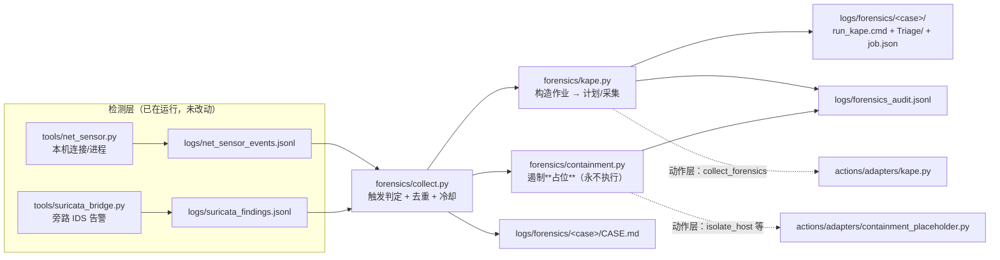

# 与 KAPE 联动：发现可疑目标 → 自动取证 → 遏制（占位）

把 AI 系统的检测结果接到 **KAPE**（Kroll Artifact Parser and Extractor）上：
一旦出现"值得深挖的可疑目标"，自动生成并（在获得批准后）执行取证采集；
**遏制阶段只做占位**，不做任何真实处置。

---

## 1. 数据流



两个关键设计：

**（1）不给检测器加回调，而是读它们写的日志。**
两个检测器已在常驻运行，且它们的结果文件本来就是权威记录。插一条进程内回调会引入
"谁先启动、谁挂了、回调抛异常会不会拖垮检测主循环"这类问题。读文件几乎零成本
（只看新增尾部），**检测器完全不需要改动** —— 对一个已经在跑的服务来说这是最重要的性质。

**（2）遏制与取证走两个不同的适配器，顺序写死。**
`containment_placeholder` 必须排在 `sim` **前面**（`actions/config.yaml` 的 `adapters.order`）。
否则遏制动作会被仿真适配器接走、返回"执行成功"，模型据此以为已经遏制完毕并推进到
根除/恢复阶段 —— 那是**假装处置**，比不处置更危险。

---

## 2. 触发条件（宁可少采，也不要让采集把机器刷爆）

一次 KAPE 采集要几分钟、产物数百 MB，所以触发刻意收紧：

| 来源 | 触发条件 |
|---|---|
| 本机传感器 | `route == auto_attack`，**或** 模型判定 `attack` 且分值 ≥ `high_threshold`(40) 且置信度高/严格 |
| 旁路 IDS | `route == auto_attack`，**或**「本机关联命中 + 模型判定 attack + 分值达标」 |

另外两条硬约束：

* **同一目标 30 分钟内只采一次**（`--cooldown`）。指纹是「来源 + 进程 + 对端 + 路径」，
  按**目标**去重而不是按事件 —— 同一个可疑进程反复外连只会采集一次。
* **未研判的高分记录不触发**。否则"分值高"会自己把自己送进取证，形成自证循环。

从记录里能还原出可执行文件路径时，会额外加一个 `file:<路径>` 标签，
把那个文件**单独复制并记录 SHA256**（只读复制，不移动原文件）。

---

## 3. 采集内容

用自带的 `forensics/targets/BlueTeam-Triage.tkape`，只取能回答
**「这个进程是什么、从哪来、做了什么、有没有持久化」** 的最小集合：

| 分组 | 取的产物 | 回答什么问题 |
|---|---|---|
| 执行痕迹 | Prefetch、Amcache、SRUM、WMI 仓储 | 这个程序何时执行过、执行了多少次 |
| 持久化 | 计划任务、启动项、SOFTWARE/SYSTEM/SECURITY/SAM 配置单元 | 重启后它还会不会起来 |
| 事件日志 | 13 个**逐个点名**的通道：Security/System/Application、
PowerShell 经典与 Operational、RDP 三件套、SMB 客户端与服务端、
Defender、防火墙、WMI-Activity、TaskScheduler、BITS（Sysmon/AppLocker 装了就有）
| 它对谁做了什么、有没有被记录 |
| 打开痕迹 | Recent 下的 LNK 与跳转列表（`!EZParser` 的 LECmd/JLECmd 直接解析） | 被打开过什么（即使用户已删掉文件） |
| 删除痕迹 | 回收站 `$I*` 删除元数据（**不收 `$R*` 实际内容**） | 被删了什么、何时删的 |
| 用户可写目录 | **只收脚本与快捷方式类**（`ps1/vbs/js/wsf/hta/bat/cmd/lnk/scf/cpl/reg/jar`）、
PowerShell 历史、`C:\Users\Public` | 它是怎么落到本机的，以及无文件投递的落点 |

**为什么用户目录不整体收 `*.exe`**：实测过，一次就产出 17826 MB，其中 16.5 GB 是
厂商安装包与开发工具缓存（Unity 3.5 GB、Ollama 1.5 GB+1.2 GB、VS Code 扩展二进制、
uv/semgrep 缓存），取证价值接近零（实测表格见 §3.3）。**「什么被执行过」
由 Prefetch/Amcache/SRUM 回答**（几百 MB 且证据力更强）；**可疑进程的镜像**由
`copy_extra_files()` 按精确路径取回并附 SHA256 清单。

**默认不用 `!SANS_Triage` 全套**：全套要跑十几分钟、产出数 GB，其中大部分内容与
"某进程可疑外连"这个具体问题无关。需要全量时把 `--artifacts full` 或
配置里 `target: "!SANS_Triage"`。

**解析用官方 `!EZParser`**（已核实存在且可用）：它依次调起 12 个 EZTools 解析器，
实战跑了一次——**18 个 processor 全部执行成功**（AmcacheParser / AppCompatCacheParser /
EvtxECmd / JLECmd / LECmd / MFTECmd / PECmd / RBCmd / RecentFileCacheParser /
RECmd / SBECmd / SQLECmd / SrumECmd / SumECmd / bstrings …）。
早期版本的本文档说"解析需自行下载 EZTools"——那是**错的**，本机 `Modules\bin` 里
早就装好了；是我没先查清就写了文档。

要把采集结果变成**时间线/CSV**（人和 AI 都能读），就把 `module` 设为 `!EZParser`；
只要原始产物就把 `module` 留空。

## 3.1 KAPE / EZTools 的实际位置与一次性配置

```
C:\Tools\KAPE\                ← **正式安装位置**（kape.exe 1.3.0.2 + gkape.exe）
    Targets\                 428 个 target（含我们的 BlueTeam-Triage.tkape）
    Modules\                 461 个 module
        bin\                 EZTools 在这里（EvtxECmd/RECmd/SQLECmd 在各自子目录）
        Compound\!EZParser.mkape
D:\work\KAPE\             ← 工作区里的旧副本（224 MB，配置已不再指向它）
C:\Tools\EZ\                  EZTools 原始下载目录（Get-ZimmermanTools.ps1）
```

一次性配置（幂等，可重跑）：

```powershell
# 在正式位置装好社区规则集 + 我们的 target + EZTools
.\tools\setup_kape.ps1 -KapeDir C:\Tools\KAPE -EzToolsFrom D:\work\KAPE\Modules\bin
```

它做四件事：备份 → 用 KapeFiles 社区集整树替换 `Targets\`/`Modules\`
（保留 `!Local` 与 `bin`）→ 安装我们的 target → **用 kape.exe 自己校验**
（`--tlist`/`--mlist`，检测语法错误与重名）。

`-EzToolsFrom` 是实测补上的：**EZTools 不由 KAPE 分发**，只拷 `kape.exe`
到新位置会得到一个 
跑得起来但解析器全缺的安装（脚本的 EZTools 检查会报“missing 12”）。
从另一个已装好的 KAPE 的 `Modules\bin` 拷过来即可。

## 3.2 `.tkape` / `.mkape` 的三个坑（都踩过）

这三个坑都**只有用真的 kape.exe 才能发现**，纯读代码/看文档都看不出来：

| 坑 | 症状 | 正确做法 |
|---|---|---|
| **非 ASCII** | `Syntax error in xxx.tkape`，target 从 `--tlist` 里静默消失 | KAPE 按 **ANSI** 解析这两个文件。含中文（UTF-8）必死。**保持纯 ASCII**，说明文字写进 `docs/` |
| **缺 `-` 列表项** | 单个条目可能忍过去，两个条目就不行了 | 结构必须是 `Targets:` → `    -` → `        Name: ...`（旧版我写成了直接接 `Name: ...`） |
| **全树重名** | `A target named X already exists at ...`，KAPE **完全无法启动** | KapeFiles 会在版本间把文件换子目录（`Targets\Windows\` → `Targets\Apps\`）。所以**不能合并**，必须整树替换 |

## 3.3 产物体积：一次实测出来的设计错误（已修）

同一个 `--tsource C:`，同一个 host，只换 target 版本：

| target 版本 | 文件数 | 体积 | 耗时 | 说明 |
|---|---|---|---|---|
| v1.1（`C:\Users\%user%\` + `*.exe` + 递归） | 1702 | **17,826 MB** | 298 s | 不可用 |
| v1.3（本版本） | 1174 | **622 MB** | 70 s | 同时**多**采了 Recent/$Recycle.Bin |

缩小 96.5%，而且不是靠“少采”换来的 —— v1.3 额外收了 Recent LNK/跳转列表（271 个）
与回收站 `$I`（8 个）。实测各位置的可执行文件成本：

| 位置 | 文件数 | 体积 |
|---|---|---|
| `C:\Users\<user>\Downloads`（`exe/msi`） | 36 | 4,248 MB |
| `C:\Users\<user>\AppData\Local\Temp`（`exe`，递归） | 302 | 4,088 MB |
| **全部 13 个事件日志通道** | 13 | **61 MB** |

结论：大体积只来自用户目录里的安装包，而它们几乎全是**有签名的厂商安装器**（
名单见 §3 的实测表）。而用户目录根部几乎没有可疑可执行文件（实测 `%TEMP%` 根部
269 个文件中 `.exe` 为 **0** 个）。

### 体积守卫（代码层）

因为 **KAPE 没有预估体积的开关，`--sim` 也不报体积**，体积只能在采完之后才知道，
所以加了事后守卫：`KapeConfig.max_collect_mb`（默认 4096，0=不限）。超预算时：
`KapeResult.oversize=True` + `warnings` 列出原因 + `detail` 加 ⚠ + 适配器观测里
明确警告。自检里包含 `size_warning()` 的多组边界用例。

真实采集后仍然应该**看一眼 `collected_mb`**，而不是只看 `status == ok`。

## 3.4 `FileMask` 的写法：四个只有实测才知道的事实

v1.2 的 target 写了 `FileMask: "*.exe;*.dll;..."`，看着很合理，实际**一条都没采到，
而且不报错**。全部通过探针 target + `--sim` + CopyLog 实测得出：

| # | 事实 | 错误写法的后果 |
|---|---|---|
| 1 | **`FileMask` 不支持分号分隔** | `"*.exe;*.dll"` 静默匹配 0 个文件。多扩展名要用官方的 **`regex:`** 形式（427 个社区 target 里没有一个用分号） |
| 2 | `regex:` 掩码**不能加双引号** | `"regex:*.+\.(exe|dll)"` 报 `unknown escape character`（YAML 对 `\.` 的转义规则），整个 target 加载失败。正确写法是**不加引号**：`FileMask: regex:*.+\.(exe|dll)` |
| 3 | **regex 是对完整路径匹配，不是文件名** | `.*(Security|System|Application)\.evtx` 会连 `Microsoft-Windows-SMBServer%4Security.evtx`、`Intel-GFX-Info%4Application.evtx` 一起匹配上（实测 8 个里 5 个是误匹）。**所以事件日志通道一个个用精确文件名点名**，不用 regex 偷懒 |
| 4 | `Recursive: false` 合法且意为“只本层目录” | 可放心用来限定“只要根部”（但要搭配“根部确实有目标文件”，否则你以为掩码坏了） |

另外：KAPE 会把 target 展开成一个**去重后的源文件集合**，所以同一个文件被两个
条目引用只会采一次（`--tdd` 去重的是**内容 SHA-1**，是另一回事）。

---

## 4. 安全设计（四道，都可验证）

| 机制 | 作用 | 怎么保证 |
|---|---|---|
| **默认演练** | 不真采集，只产出可直接提权执行的 `run_kape.cmd` + `job.json` | 要真采集必须显式 `--execute` |
| **第二道开关** | 即使执行器把 `dry_run=false`，也只在配置里 `kape.execute_enabled: true` 时才真跑 | 见 `forensics/kape.py` 的 `KapeConfig` |
| **产物 jail** | `--tdest/--mdest` 只允许落在 `output_root` 内 | `validate()` 里做路径归属检查，越界直接拦下 |
| **非管理员拒绝执行** | 避免产出**残缺证据** | `require_admin: true` 时返回 `unavailable` 并给出提权用的 .cmd |

其中**第四条最容易被忽略但最要紧**：KAPE 的注册表配置单元 / SRUDB / 事件日志在非管理员下
取不全。取不全的产物拿去研判，会让人得出「没有持久化项」这种**错误结论** ——
**残缺的取证比没有取证更危险**。所以这里宁可拒绝执行、把命令交给操作员。

顺带两个刻意的取舍（**已对着真实的 `kape.exe --help` 1.3.0.2 核实**）：

* 只用这些参数：`--tsource/--tdest/--target/--tvars/--mdest/--module/--sim`
* **不隐式加 `--tflush`/`--mflush`** —— 它们会**删除目录内容**，属于破坏性参数
* **不隐式加 `--vhdx`/`--zip`** —— 容器化会多一层开销，要就显式写 `extra_args`
* 核实到一条事实：**1.3.0.2 里根本没有 `--sync`**。（早期注释里写的是"不猜 --sync"，
  现在可以确定它真不存在。另有 `--sim` = 不复制只校验，已作为一等选项接入。）
* 自动加 `--tvars user:<当前用户>`：我们的 target 用了 `%user%`，
  不传这个变量那几个条目会**静默取不到**（不报错、但产物里就没有）

---

## 5. 遏制为什么只做占位

`forensics/containment.py` 里**没有任何执行能力**（不 import `subprocess`、
不调用任何系统变更 API），返回值 `executed` 恒为 `False`。
它提供的价值是「该做什么 + 代价是什么」，而不是「已经做了」：

* 每个动作给出**计划命令**、**前置条件**、**已知坑**；
* 缺参数时命令里明确写 `<src_ip未提供>`，**不伪装成一条完整命令**
  （避免被复制粘贴执行）;
* 跨阶段动作如实说明（例如 `reset_credential` 属**根除(E)** 而非遏制，
  本模块不代拟命令）。

"已知坑"这一栏不是装饰，每条都对应真实会踩的错：

| 动作 | 项目实测到的错法 |
|---|---|
| `block_ip` | 打到**受害主机自己的 IP**（41.7%）；方向写成 inbound（95.8%，回连应堵出向） |
| `isolate_host` | **切断你自己的远程会话** —— 用远控/远程桌面在操作时，执行瞬间就失联且无法自行解除 |
| `kill_process` | 杀进程会销毁内存证据；有守护的恶意程序会立刻重启，杀进程基本无效 |
| `quarantine_file` | 不先算哈希就无法做情报比对与溯源；**签名有效 ≠ 无害，但签名有效的文件误隔离代价很高** |

想接真实处置能力时，**不要改这个文件**：另写一个适配器
（如 `containment_firewall.py`），在 `adapters.order` 里排到它前面，
并把 `placeholder_only` 置 false。这样"占位"与"真执行"是两个可审计的文件，
不会出现"哪天有人顺手把占位改成真执行、没人发现"的情况。

---

## 6. 怎么用

**第一步：一次性配置 KAPE（幂等，可重跑）**

```powershell
.\tools\setup_kape.ps1 -KapeDir D:\work\KAPE
```

**第二步：先只校验配置（不复制任何文件）**

```powershell
# KAPE 原生 --sim：跑一遍 target+module，但不把产物复制下来
.\\.venv\\Scripts\\python.exe -m forensics.kape --case verify-01 --artifacts triage --sim --execute --module '!EZParser'
```

⚠ `--sim` 下 Parsed 里的 CSV 是**基于空目录**算出来的，**不要据此研判**；
它的价值是证明 target / module / 路径都合法。

**第三步：演练（默认）——只产计划，连 KAPE 都不启动**

```powershell
.\\.venv\\Scripts\\python.exe -m forensics.collect --once
.\\.venv\\Scripts\\python.exe -m forensics.collect --once --from-end --from-file logs\\net_sensor_events.jsonl
.\\.venv\\Scripts\\python.exe -m forensics.collect --loop --interval 30      # 常驻看护
```

**第四步：真实采集（需管理员；KAPE 连 --tlist 都要求提权）**

```powershell
.\\.venv\\Scripts\\python.exe -m forensics.collect --execute --module '!EZParser'
```

产物：

```
logs/forensics/<case_id>/
    run_kape.cmd      ← 可直接以管理员身份运行的完整命令行（执行前请核对）
    job.json          ← 作业描述 + 阻断项/提醒项 + 是否管理员 + 是否演练
    Triage/           ← 采集产物（真实采集后）
    ExtraFiles/       ← 单独特定的可疑文件 + manifest.json（含 SHA256）
    CASE.md           ← 案例报告：采集情况 + 遏制占位计划 + 局限
logs/forensics_audit.jsonl   ← 每次触发的审计流水
```

查看某个案例：`type logs\forensics\<case_id>\CASE.md`

---

## 7. 与动作层的关系

`actions/adapters/kape.py` 把白名单里**已有**的 `collect_forensics` 动作
（`ActionSpec(("host_id","artifacts"), ("case_id",), irreversible=False, "采集取证镜像/内存")`）
路由到 `forensics/kape.py`。**没有改安全基线**，也没有新增动作名。

`actions/adapters/containment_placeholder.py` 接管遏制(C)阶段的 8 个动作，
永远返回"已登记计划、未执行"。

---

## 8. 已验证 / 未验证

**本机自动化验证（不需要 KAPE，也不需要管理员）**

| 测试 | 内容 | 结果 |
|---|---|---|
| `python -m forensics.kape --selftest` | 命令构造、jail 校验、演练不执行、缺 KAPE 时演练仍出计划/真执行则 unavailable、单独取回文件+SHA256、非管理员拒绝 | **21/21** |
| `python -m forensics.containment --selftest` | 占位永不执行（**AST 检查**确认模块无执行能力）、缺参数不伪装、跨阶段动作如实说明、按规则给建议 | **14/14** |
| `python -m forensics.collect --selftest` | 触发判定、冷却、增量读取、审计、案例报告、**适配器路由（遏不至 sim）** | **28/28** |
| `python -m actions.cli selftest` | 动作层回归（新增适配器未破坏既有行为） | **38/38** |
| 真实演练 | 对实际 `logs/*.jsonl` 跑一轮：59 条记录 → 26 次触发 → 生成案例报告 | 通过 |

**已用真机真 KAPE 验证**

| 测试 | 内容 | 结果 |
|---|---|---|
| `tools/setup_kape.ps1` | 备份 → 整树替换 → 装 target → **kape.exe 自校验** | 无语法错误 / 无重名；target 与 `!EZParser` 均可见 |
| `--tlist .` / `--mlist .` | 427 target / 461 module | 通过 |
| **真实 `--sim` 跑穿整链** | `kape.exe --tsource C: --target BlueTeam-Triage --tvars user:user --module !EZParser --sim` | **退出码 0；18 个 EZTools processor 全部执行成功**（149s） |
| `python -m forensics.kape --selftest` | 命令构造（tvars/sim/不带破坏性参数）、jail、演练、缺 exe、非管理员 | **22/22** |
| `python -m forensics.containment --selftest` | 占位永不执行（AST 验证） | **14/14** |
| `python -m forensics.collect --selftest` | 触发/冷却/增量/审计/报告/**适配器路由** | **28/28** |
| `python -m actions.cli selftest` | 动作层回归 | **38/38** |

**仍然未验证的**

* **一次完整的真实采集**（不复制文件的 `--sim` 已跑通，但"真的把产物复制下来"
  这一步还没跑过）。耗时长（本机 `C:\Users` 下 `*.exe` 全扫）且产物可能上百 MB，
  需要时再手动发起。
* 各 target 的 `Path`/`FileMask` 在**别的机器**上是否命中（每台机器的目录结构不同）
* 真实 SOAR/EDR 的遏制实现（当前只有占位）

**局限**

1. 遏制是占位，**系统不会自动处置任何东西**（这是刻意的）。
2. 取证触发依赖检测结果的质量 —— 检测误报会带来无意义的采集（会消耗时间与磁盘）。
3. 采集产物本身即敏感数据（含注册表配置单元与事件日志），需按证据链要求保管。
4. 「内存镜像」标签是占位说明：本工具不做内存取证。
