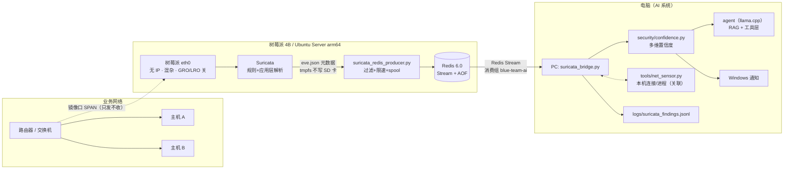
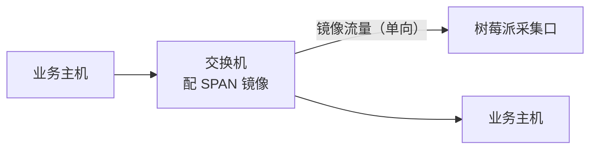
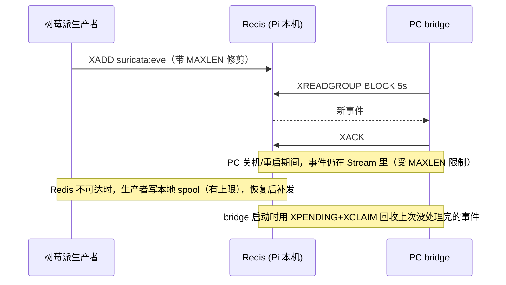

# 树莓派旁路 IDS + PC 侧 AI 分析

树莓派 4B（4GB）跑 Ubuntu Server 22.04.5 LTS（64-bit ARM）+ Suricata，
**旁路镜像**采集流量、只读不干扰业务；告警经 **Redis Stream** 送到电脑上的
AI 系统做研判。两端同时运行：树莓派看**报文**，电脑看**进程**，关联起来证据才闭合。



---

## 1. 硬件与接线（先想清楚这一层）

树莓派 4B **只有一个原生以太网口**。它要么当采集口，要么当管理口，不能同时是两者。
所以有两种接法：

| 方案 | 采集口 | 管理口 | 说明 |
|---|---|---|---|
| A（推荐） | 板载 `eth0` → 交换机镜像口 | **板载 WiFi** | 零额外成本。WiFi 只用于 SSH/维护，不承载分析流量 |
| B（更稳） | **USB3 千兆网卡** → 镜像口 | 板载 `eth0` | 管理链路不依赖 WiFi；多花一个网卡钱 |

**交换机侧**需要配 SPAN / 端口镜像：把要观察的端口（或整个 VLAN）镜像到一个指定端口，
那个端口只接树莓派的采集口。**不要**把树莓派串在链路中间（那就成了 Inline 模式，
会转发流量、可能丢包、可能断网 —— 与本方案"不干扰业务"的目标相反）。



> 如果没有可管理交换机：家用场景可以用"端口镜像型"的小交换机，或在路由器上做镜像。
> 不要用普通集线器（现在基本买不到，且速率只有百兆）。

**安装脚本会挡住一个致命错误**：如果你把采集口选成了当前默认路由/SSH 所在的网卡，
`install_pi.sh` 会直接拒绝执行 —— 因为下一步会把该网卡改成无 IP，你会立刻失联，
而树莓派没有屏幕，只能拔卡重刷。

---

## 2. 烧录系统

### 2.1 关于国内镜像（实测结论，别浪费时间试）

我实测了这些（2026-10-04，从本机发 HEAD 请求）：

| 用途 | 地址 | 结果 |
|---|---|---|
| apt 源（arm64） | `mirrors.tuna.tsinghua.edu.cn/ubuntu-ports` | ✅ 可用 |
| apt 源（arm64） | `mirrors.ustc.edu.cn/ubuntu-ports` | ✅ 可用 |
| **镜像文件** | 各站 `ubuntu-cdimage/releases/22.04.5/release/…` | ❌ **tuna / ustc / bfsu / sjtug / nju / zju / iscas / cqu / hit / aliyun / 163 / huawei 全部 404** |
| 镜像文件 | `cdimage.ubuntu.com/releases/22.04.5/release/...` | ✅ 200（官方） |

也就是说：**apt 换国内源很有用，但树莓派版 Ubuntu 镜像文件国内镜像站并没有镜像**。
所以下载工具 `tools/get_ubuntu_image.ps1` 采用**运行时探测**：
按"国内镜像 → 官方"顺序逐个 HEAD 探测，谁可用用谁；将来某个镜像站补上了，
它会自动改用镜像站，不需要改代码。

```powershell
# 看看当前哪些地址可用（只探测，不下载）
.\tools\get_ubuntu_image.ps1 -ListOnly

# 下载（支持断点续传，Ctrl+C 后重跑即可续）
.\tools\get_ubuntu_image.ps1 -Verify          # 下载并核对 SHA256

# 如果官方源慢：它支持 Range 请求，用多线程下载器会快很多
#   aria2c -x16 -s16 <上面列出的 OK 地址>
```

> `-Verify` 会拉官方 `SHA256SUMS` 并核对，**不匹配就明确报错**。
> 刷写前的这一步别省：镜像损坏的表现是"能刷进去但起不来"，很难查。

### 2.2 写入 SD 卡 / USB SSD

**强烈建议用 USB3 SSD 而不是 SD 卡**。原因不是速度，是寿命：
Suricata 日志 + Redis AOF 是持续写入，SD 卡在这种负载下几个月就可能写坏，
而且坏的方式往往是"能开机但随机 I/O 错误"，非常难查。
（本方案已经把 `eve.json` 放到 tmpfs 并关掉了 RDB 快照来减少写入，
但 SSD 仍是更省心的选择。）

1. 用 **Raspberry Pi Imager** → `Choose OS` → `Use custom` → 选下载好的 `.img.xz`
2. 点齿轮（高级设置），**刷写前**设好：
   - hostname：`ids-pi`
   - **启用 SSH**，并粘贴你的公钥（这样后面的 SSH 部署不用输密码）
   - 用户名：**`ubuntu`**（Ubuntu Server 镜像的默认用户是 `ubuntu`，**不是** `pi`）
   - WiFi：只在方案 A（管理走 WiFi）时需要配
3. ⚠ **不要给 `eth0` 配静态 IP** —— 安装脚本会把它改成纯采集口（无 IP）

---

## 3. 通过 SSH 部署

一次性的密钥配置（只做一次）：

```powershell
ssh-keygen -t ed25519                      # 已有密钥就跳过
type $env:USERPROFILE\.ssh\id_ed25519.pub | ssh -p 22 ubuntu@ids-pi "mkdir -p ~/.ssh && chmod 700 ~/.ssh && cat >> ~/.ssh/authorized_keys && chmod 600 ~/.ssh/authorized_keys"
ssh ubuntu@ids-pi true                     # 能返回即成功
```

然后一条命令部署（会 scp 文件、换源、装 Suricata/Redis、调优采集口、起服务、跑自检）：

```powershell
# 最基本：采集口 eth0，apt 走清华源
.\tools\pi_deploy.ps1 -Host ids-pi -Iface eth0 -Mirror tuna

# 管理口是 eth0、采集口是 USB 网卡 eth1（方案 B）
.\tools\pi_deploy.ps1 -Host ids-pi -Iface eth1 -Mirror tuna

# 国内直连 rules.emergingthreats.net 很慢时：走代理拉规则集
.\tools\pi_deploy.ps1 -Host ids-pi -Iface eth0 -Mirror tuna -Proxy http://192.0.2.10:7890

# 完全离线：先把 emerging.rules.tar.gz 拷到树莓派，再用本地规则集
.\tools\pi_deploy.ps1 -Host ids-pi -Iface eth0 -Mirror tuna -RulesTarball /home/ubuntu/emerging.rules.tar.gz

# 只重新跑自检（改完配置后）
.\tools\pi_deploy.ps1 -Host ids-pi -Verify
```

`pi_deploy.ps1` 的取舍：
- **不传密码**。脚本只用密钥认证；密钥没配好时它会打印需要你手动执行的命令然后退出
  （把密码塞进脚本/环境变量是一个常见的坏习惯，这里不这么做）。
- `sudo` 密码由 **你在自己的终端里输入**（用 `ssh -t` 分配 TTY）。
- 安装结束时生成的 Redis 密码会打印在**你的终端**上。它存在树莓派的
  `/etc/default/blueteam-ids`（权限 600）。**不要把它贴到任何聊天/工单里。**

也可以手动部署（不用上面的脚本）：

```bash
# 在 PC 上
scp -r raspi-ids ubuntu@ids-pi:/tmp/blueteam/
# 在树莓派上
sudo bash /tmp/blueteam/raspi-ids/install_pi.sh --iface eth0 --mirror tuna
```

### `install_pi.sh` 主要参数

| 参数 | 说明 |
|---|---|
| `--iface NAME` | 采集口（镜像口）网卡名，默认 `eth0` |
| `--mirror NAME` | 换 apt 源：`tuna`/`ustc`/`aliyun`/`huawei`/`163`/`bfsu`（arm64 会用 `ubuntu-ports`） |
| `--proxy URL` | 给 `suricata-update` 用的代理 |
| `--rules-tarball PATH` | 用本地 `emerging.rules.tar.gz` 代替联网下载 |
| `--broker HOST:PORT` | Redis 地址。默认 `127.0.0.1:6379`（Redis 装在树莓派自己身上） |
| `--no-redis` | 不装本机 Redis（改用 PC 上的 Redis 时用） |
| `--home-net CIDR` | 覆盖 Suricata 的 `HOME_NET` |
| `--max-eps N` | 转发限速（条/秒），默认 600 |
| `--maxlen N` | Stream 长度上限，默认 200000 |
| `--dry-run` | 只打印将要做什么 |

---

## 4. 在电脑上运行 bridge

```powershell
cd D:\work\blue-team-agent
$env:IDS_REDIS_PASSWORD = '<安装时打印的密码>'      # 或给 --password（不推荐，会进命令行历史）

# 完整功能：关联 + AI 研判 + 通知
.\.venv\Scripts\python.exe tools\suricata_bridge.py --broker 192.0.2.50:6379 --llm --notify

# 省资源：不叫模型，只做规则打分 + 关联 + 通知
.\.venv\Scripts\python.exe tools\suricata_bridge.py --broker 192.0.2.50:6379 --no-llm --notify

# 出报告
.\.venv\Scripts\python.exe tools\suricata_bridge.py --report 2026-10-04
```

开机自启（与本机传感器一起常驻）：

```powershell
.\tools\install_bridge_task.ps1 -Broker 192.0.2.50:6379 -Install
```

### 关键参数

| 参数 | 默认 | 说明 |
|---|---|---|
| `--threshold` | 30 | 触发 AI 的分值阈值 |
| `--heuristic-min` | 20 | 启发式多少分才落盘。落在 `[20,30)` 的**会记录但不占模型配额** |
| `--cooldown` | 600 | 同一指纹（签名+五元组）多久只报一次 |
| `--max-llm-per-min` | 3 | 模型调用限速；超限按**分值优先**排队，不丢弃高分事件 |
| `--corr-window` | 120 | 与 `logs/net_sensor_events.jsonl` 做关联的时间窗（秒） |
| `--high-band` / `--low-band` | 0.70 / 0.40 | 多维置信度的自动处置门限；中间区间只记录不弹通知 |
| `--reclaim-idle` | 60 | 回收"上一次运行没处理完"的遗留事件（见下面的排障） |
| `--no-heuristics` | — | 关掉对 dns/tls 形状的低分启发式 |
| `--replay FILE` | — | 回放一份 eve 文件（不连 Redis，可离线验证整条链路） |

---

## 5. 数据流、容量与资源

### 5.1 只传元数据，不上传载荷

生产者在树莓派侧就把 `payload` / `payload_printable` / `packet` / `http-body` 全部丢弃
（`suricata_redis_producer.py` 的 `DROP_KEYS`），并默认**不转发 `flow` 事件**。
原因有两条，都很实际：

- **带宽**：镜像口上一个 `flow` 事件每秒能产生上万条，转发它会把 LAN 和 PC 打满，
  而它对研判几乎没有增量信息（电脑侧的连接级信息已由 `net_sensor.py` 覆盖）。
- **隐私**：电脑上只留"哪条规则命中、什么五元组、什么 SNI/域名/UA"，
  不留业务流量内容。这一点在旁路部署里尤其重要 —— 镜像口看到的是**别人的流量**。

默认转发的类型：`alert` `anomaly` `dns` `tls` `http` `ssh` `fileinfo`（以及少数几个）。
需要更多类型时改 `--forward`。

### 5.2 容量估算

| 项 | 量级 | 说明 |
|---|---|---|
| 转发事件速率 | 典型几十~几百条/秒 | 取决于网络规模；生产者默认限速 600/s 保护 LAN |
| 每条事件大小 | ~300–800 字节 | 已裁剪字段；无载荷 |
| 对应带宽 | **< 2 Mbps** | 对千兆 LAN 可忽略 |
| Redis 内存 | XADD `MAXLEN ~ 200000` ≈ 80 MB | 配置里 `maxmemory 256mb` + `noeviction` 兜底 |
| 树莓派采集能力 | **约 100–300 Mbps** | RPi 4B + ET Open 规则的实际上限；`verify_pi.sh` 会报平均速率 |
| 树莓派进程占用 | Suricata ~600MB/2 核，Redis ~30MB，转发器 ~30MB | 4GB 机型宽裕 |

**如果镜像口流量超过约 300 Mbps**，树莓派会开始丢包。这不是配置问题，是硬件上限。
判断方法就是看 `verify_pi.sh` 报的丢包率与平均速率 ——
**丢包率是这套装置能不能被信任的前提**，比"有没有告警"重要得多。

### 5.3 断线不丢数据



三个刻意的选择：
1. **Redis 装在树莓派上**（而不是 PC 上）。这样 PC 关机期间事件仍进本机 Stream，
   PC 回来能补上；如果反过来，PC 一关机生产者就只能落盘缓冲。
2. **`appendonly yes` + 关掉 RDB 快照**：Pi 上 fork 抖动明显，AOF 已足够。
3. **`maxmemory-policy noeviction`**：淘汰策略会**静默删掉** stream 数据（连消费组元数据
   一起），表现为"随机丢事件且无任何报错"。宁可写入失败（生产者会落 spool）。

---

## 6. 树莓派侧做了什么调优（以及为什么）

| 项 | 值 | 原因 |
|---|---|---|
| 采集口不配 IP | — | 纯被动采集；配了 IP 就等于把这台机器接进了业务网段 |
| 混杂模式 | 开 | 镜像口送来的帧目的 MAC 不是树莓派 |
| **GRO / LRO 关闭** | off | 这两个是接收侧的帧合并优化，会把多个包合成一个"伪包"交给 Suricata，**包边界/HTTP 切分全部失真**，规则匹配不到 —— 隐性丢检测，最容易被忽略的坑 |
| 关闭 rx/tx/tso/gso/sg | off | 有些特性互相依赖，不关掉 gro 关不掉 |
| `af-packet` ring/block/buffer | 10000 / 131072 / 262144 | 吸收镜像口突发，主要降内核丢包 |
| `threads: 2`（共 4 核） | 2 | 留 1~2 核给 Redis/转发器/系统，否则整体抖动变大 |
| `runmode: autofp` | — | 配合 `cluster_flow`：同一条流固定交给同一线程，避免流状态跨线程搬 |
| `stream.memcap` / `flow.memcap` | 256mb / 128mb | 4GB 机器上必须封顶，否则流表涨满 OOM |
| `detect.profile` | medium | high 档在 Pi 上 CPU 不够，收益也有限 |
| `stats.interval` | 30s | 丢包率必须定期上报，否则无法判断设备是否可信 |
| `eve.json` 放 **tmpfs** | 64MB | 不写 SD 卡（写坏 SD 卡是这类装置最常见的死法） |
| CPU 调频 | `performance` | 默认 powersave 在突发流量下掉帧，比缺 CPU 更容易丢包 |
| `swappiness` | 10 | 减少抖动 |

配置修改方式是**最小补丁 + 读回校验**（`tune_suricata.py`），不整体替换发行版的
`suricata.yaml`：那份文件是和该版本二进制配套验证过的，自己手写一份少一个必需键就起不来。
改完会跑 `suricata -T` 做硬校验，校验不过**不会启用服务**，并保留 `.orig-blueteam` 备份。

---

## 7. 排障手册

### 7.1 树莓派侧

| 症状 | 原因 / 处理 |
|---|---|
| `tcpdump -ni eth0` 一个包都没有 | 镜像口没配好或线接错口。**先解决这个**，其他全是空转 |
| `verify_pi.sh` 报丢包率 > 1% | ① 调大 `af-packet` 的 `ring-size`/`buffer-size`；② 降低规则集（`disable.conf`）；③ 关掉更多 eve 类型；④ 流量确实超了 Pi 的采集上限（≈300Mbps）→ 换硬件 |
| `decoder.invalid` 持续增长 | 常是校验和被硬件 offload 改过。确认 `GRO/LRO` 已关；仍异常时把 `stream.checksum-validation` 设为 `no` |
| Suricata 起不来 | `journalctl -u suricata-ids -n 50`；配置问题用 `python3 /opt/blueteam-ids/tune_suricata.py --restore` 回滚 |
| 规则集是空的 | `rules.emergingthreats.net` 国内常超时 → 用 `--proxy` 或 `--rules-tarball`。**没有规则集时只有解码统计，不会告警** |
| 服务起不来但没明显报错 | 检查行尾：CRLF 的 `.service`/`.conf` 会让 systemd/redis 静默失败。在 PC 上跑 `raspi-ids/tests/syntax_check.sh` 可检出（Windows 上经 WSL） |
| apt 报 `Unable to locate package` | 源对了但**架构错了**：arm64 必须用 `ubuntu-ports`，不是 `ubuntu` |

### 7.2 PC 侧

| 症状 | 原因 / 处理 |
|---|---|
| `连不上 Redis` | 树莓派 `systemctl status redis-server`；密码对不对（`IDS_REDIS_PASSWORD`）；树莓派防火墙放行 6379；`bind` 里是否包含 LAN 地址 |
| 心跳里 `事件 0` 一直不动 | ① 树莓派上 `journalctl -u ids-producer`；② `verify_pi.sh --test-push` 看是否写进 Stream；③ 消费组是否已存在（第一次运行会建组，从 `$` 开始，**建组前的事件不会被投递**） |
| 某个时间点之后告警变少 | 很可能是**上次运行崩溃留下了未确认事件**。bridge 启动时会自动回收（`--reclaim-idle`）；确认心跳里的"回收"计数 |
| 关联命中率恒为 0 | 本机传感器在跑吗（`logs/net_sensor_events.jsonl` 在增长吗）；`--corr-window` 是否太小；对端是不是**别人的**流量（那种情况本来就没有主机级证据） |
| 通知太多 | 调高 `--high-band` 或 `--threshold`；先看报告里 `review` 档的条目，再决定是否收紧。**不建议**用 `threshold.config` 去抑制 —— 抑制掉就再没有交给 AI 判断的机会了 |
| 模型配额总是满 | 说明告警量确实大：先看报告里的高频签名，用 `disable.conf` 从规则集层面减少；同时 `--max-llm-per-min` 可适度上调 |

---

## 8. 已验证 / 未验证（务必分清）

**已在开发机（Windows）上自动化验证**（不需要树莓派）：

| 测试 | 内容 | 结果 |
|---|---|---|
| `tools/redis_lite.py --selftest` | RESP 协议、Stream、消费组、BLOCK 唤醒、**XPENDING+XCLAIM 回收** | **30/30** |
| `raspi-ids/suricata_redis_producer.py --selftest` | 事件压缩、载荷丢弃、限速、spool 补发 | **26/26** |
| `raspi-ids/tune_suricata.py --selftest` | 块/键定位、**打补丁后仍是合法 YAML**、幂等、dry-run、兄弟项未被破坏 | **39/39** |
| `tools/suricata_bridge.py --selftest` | 打分模型、类别分隔符两种形式、关联、丢包率、提示词 | **27/27** |
| `raspi-ids/tests/e2e_local.py` | **真跑生产者为子进程 → 真实 RESP → bridge**：转发/丢弃/载荷不上传/关联命中/报告 | **24/24** |
| `raspi-ids/tests/syntax_check.sh`（经 WSL） | shell 语法、python 语法、**CRLF 检查**、systemd unit 字段 | 通过 |

**必须在真机上才能验证的**（本机没有树莓派、没有 Suricata）：

- `suricata -T` 对你实际版本的配置校验（安装脚本会自动跑，**不过就不会启用服务**）
- 镜像口实际能否看到流量、实际丢包率与采集速率
- 真实网络下的告警量与误报率（需要用报告跑一段时间的数据来调 `disable.conf`）
- Redis 跨网段连接、防火墙、systemd unit 在真机上的启动顺序

**架构性的局限**（不是 bug）：

1. **看不到加密内容**：TLS 流量只能靠 SNI/证书/JA3 与流特征，看不到内部指令。
2. **签名引擎会误报**：本方案靠多维置信度过滤（`auto_attack` 才弹通知），
   但 `review` 档仍需人工确认。
3. **关联只覆盖本机**：其他内网主机之间的流量没有主机级进程证据，
   这类事件只告警不自动定性。
4. **只读**：不阻断、不执行动作。所有建议动作需人工确认。
5. 单机部署、无高可用：树莓派挂了就断采（但 PC 侧仍有本机传感器在跑）。

---

## 9. 相关文件

```
raspi-ids/
  install_pi.sh                      一键安装（含安全闸、换源、离线规则包）
  verify_pi.sh                       自检：丢包率/采集/Redis/转发器/端到端
  tune_suricata.py                   suricata.yaml 最小补丁 + 读回校验 + suricata -T
  suricata_redis_producer.py         eve → Redis Stream（单文件自包含，仅标准库）
  mirrors/setup_mirrors.sh           apt/pip 换国内源（arm64 → ubuntu-ports）
  net/90-ids-capture.yaml            netplan：采集口无 IP
  net/ids-capture-tuning.sh          关 GRO/LRO、开混杂、开大环形缓冲
  redis/redis-ids.conf               Redis 覆盖配置（noeviction / 密码 / 危险命令禁用）
  suricata/disable.conf              规则集层面的降噪（保守，按组而非硬编码 SID）
  suricata/threshold-ids.conf        运行时抑制模板（默认不抑制任何规则）
  systemd/*.service                  三个 unit（采集调优 / Suricata / 转发器）
  tests/eve-sample.jsonl             真实格式的测试样本
  tests/e2e_local.py                 端到端测试（生产者→RESP→bridge）
  tests/syntax_check.sh              静态检查（bash -n / py_compile / CRLF）

tools/
  redis_lite.py                      零依赖 RESP 客户端 + 内存假服务器（可测试）
  suricata_bridge.py                 PC 侧消费者：归一化 + 关联 + AI 研判 + 通知 + 报告
  pi_deploy.ps1                      SSH 远程部署（只用密钥，不传密码）
  get_ubuntu_image.ps1               镜像下载（运行时探测国内镜像，官方兜底）
  install_bridge_task.ps1            bridge 的开机自启计划任务
```
